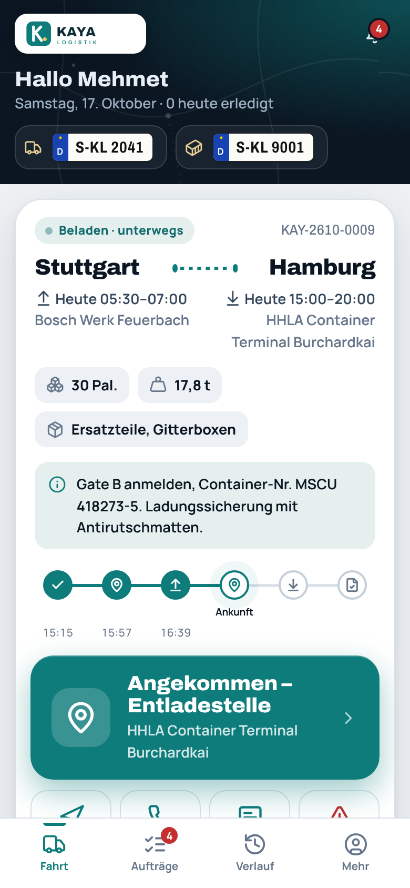
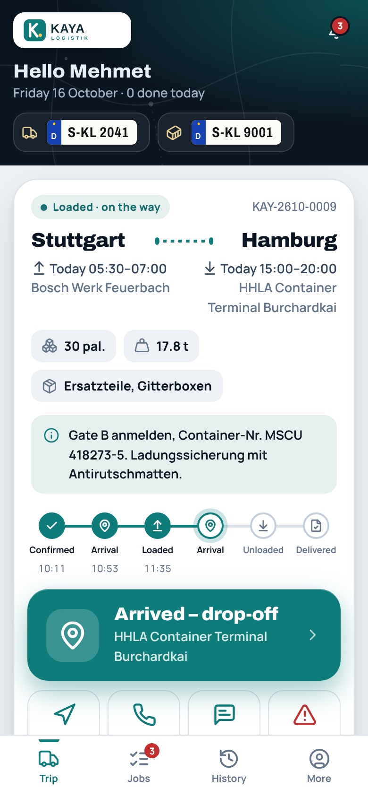
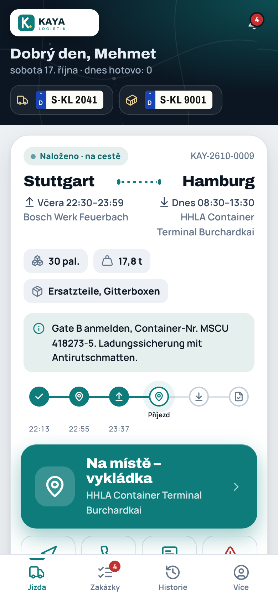
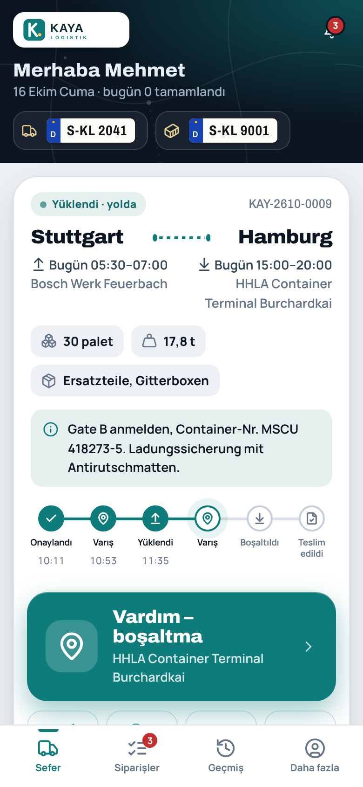
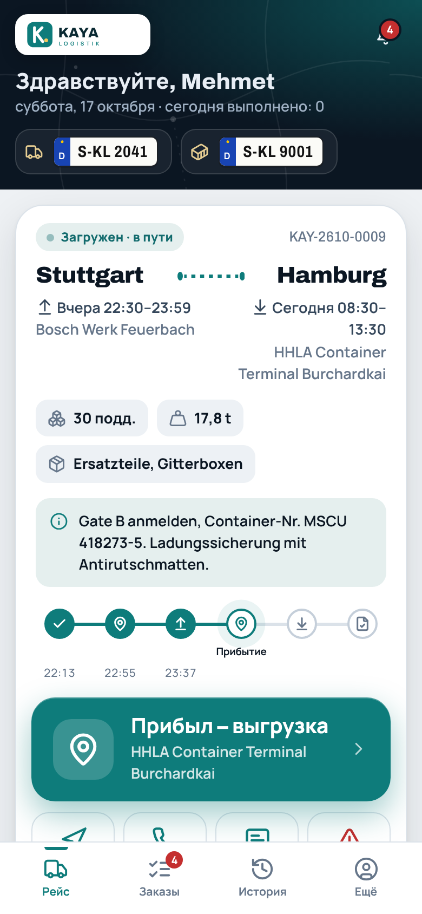
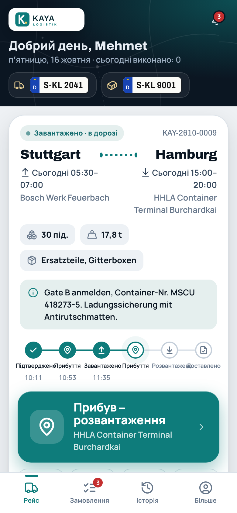

# Ladeklar – Fahrer-Kurzanleitung

Eine Seite je Sprache zum Ausdrucken und Weitergeben. Die App trägt den Namen und das Logo Ihrer Firma – die Knöpfe sind überall gleich.

[Deutsch](#deutsch--kurzanleitung-für-fahrer) · [English](#english--quick-guide-for-drivers) · [Polski](#polski--krótka-instrukcja-dla-kierowców) · [Română](#română--ghid-rapid-pentru-șoferi) · [Čeština](#čeština--stručný-návod-pro-řidiče) · [Türkçe](#türkçe--sürücüler-için-kısa-kılavuz) · [Русский](#русский--краткая-инструкция-для-водителей) · [Українська](#українська--коротка-інструкція-для-водіїв)

## Deutsch – Kurzanleitung für Fahrer

**✔ Der große grüne Knopf ist immer der nächste Schritt.** Einmal tippen – das Büro sieht es sofort.

### Anmelden

1. Öffne den Link oder scanne den QR-Code von deiner Firma. Gib deine **PIN** (6 Ziffern) ein – fertig.
2. Ohne Link: Reiter **Fahrer** → **Firmencode** + **Handynummer** + **PIN (6 Ziffern)** → **Los geht’s**.

PIN vergessen? Ruf die Disposition an. Du bekommst sofort eine neue PIN.

### Deine Tour

1. **LKW wählen** – tippe auf dein Kennzeichen. Graue Fahrzeuge sind belegt. Wenn nötig, Auflieger dazu → **Fertig**.
2. ✔ **Buchung bestätigen** – bei freien Aufträgen heißt der Knopf **Auftrag übernehmen**.
3. ⬆ **Aufgeladen** – wenn die Ware auf dem LKW ist.
4. ⬇ **Abgeladen** – wenn die Ware beim Kunden ist.
5. 📷 **Lieferschein fotografieren** – mehrere Seiten gehen (**Weitere Seite**). Name des Empfängers eintragen, wenn verlangt unterschreiben lassen.
6. ✔ **Bestätigen & abschließen** – fertig. Der Lieferschein ist sofort im Büro.

Manche Firmen nutzen zusätzlich **Angekommen – Ladestelle** / **Angekommen – Entladestelle** oder fragen beim Abladen den **Palettentausch** ab. Der Knopf erscheint dann von selbst.

### Immer auf der Tour-Karte

- 🧭 **Navi** – öffnet die Route in Google Maps.
- 📞 **Anrufen** – ruft die Lade- oder Entladestelle an, sonst die Disposition.
- **Notiz** – kurze Nachricht ans Büro, mit Schnelltexten wie „Warte an der Rampe“.
- ⚠ **Problem** – Grund antippen (z. B. Panne, Unfall, Lange Wartezeit) → **Jetzt melden**. Ein Foto geht auch.

### Gut zu wissen

- **Falsch getippt?** Unten erscheint **Rückgängig** – 2 Minuten lang.
- **Kein Netz?** Einfach weiter tippen. Alles wird gespeichert und automatisch gesendet, sobald Netz da ist. Erst mit Netz abmelden.
- **Nur im Stand mit Motor aus bedienen (§ 23 StVO).** Während der Fahrt sperrt sich die App.
- **Tour abgeben?** Vor dem Beladen: **Zurückgeben** + Grund. Nach dem Beladen: Disposition anrufen.
- **Sprache ändern:** unten **Mehr** → **Sprache**.

## English – Quick guide for drivers

**✔ The big green button is always the next step.** One tap – the office sees it right away.

### Sign in

1. Open the link or scan the QR code from your company. Enter your **PIN** (6 digits) – done.
2. No link? Tab **Drivers** → **Company code** + **Mobile number** + **PIN (6 digits)** → **Let’s go**.

Forgot your PIN? Call dispatch. You get a new PIN right away.

### Your trip

1. **Choose truck** – tap your number plate. Grey vehicles are in use. Add a trailer if needed → **Done**.
2. ✔ **Confirm booking** – for available jobs the button says **Take job**.
3. ⬆ **Loaded** – when the goods are on the truck.
4. ⬇ **Unloaded** – when the goods are at the customer.
5. 📷 **Photograph delivery note** – several pages are possible (**Another page**). Enter the recipient’s name; get a signature if required.
6. ✔ **Confirm & finish** – done. The delivery note is in the office at once.

Some companies also use **Arrived – pickup** / **Arrived – drop-off** or ask for the **Pallet exchange** when unloading. The button then appears by itself.

### Always on the trip card

- 🧭 **Navigate** – opens the route in Google Maps.
- 📞 **Call** – calls the pickup or drop-off point, otherwise dispatch.
- **Note** – short message to the office, with quick texts such as “Waiting at the ramp”.
- ⚠ **Problem** – tap the reason (e.g. Breakdown, Accident, Long waiting time) → **Report now**. You can add a photo.

### Good to know

- **Tapped by mistake?** **Undo** appears at the bottom – for 2 minutes.
- **No signal?** Just keep tapping. Everything is saved and sent automatically as soon as there is signal. Sign out only when you have signal.
- **Use the app only when stationary with the engine off (§ 23 StVO).** The app locks itself while driving.
- **Give back a trip?** Before loading: **Return** + reason. After loading: call dispatch.
- **Change language:** at the bottom **More** → **Language**.

## Polski – Krótka instrukcja dla kierowców

**✔ Duży zielony przycisk to zawsze następny krok.** Jedno dotknięcie – biuro widzi to od razu.

### Logowanie

1. Otwórz link albo zeskanuj kod QR od swojej firmy. Wpisz **PIN** (6 cyfr) – gotowe.
2. Bez linku: zakładka **Kierowca** → **Kod firmy** + **Numer telefonu** + **PIN (6 cyfr)** → **Zaczynamy**.

Zapomniany PIN? Zadzwoń do dyspozytora. Od razu dostaniesz nowy PIN.

### Twoja trasa

1. **Wybierz ciężarówkę** – dotknij swojego numeru rejestracyjnego. Szare pojazdy są zajęte. W razie potrzeby dodaj naczepę → **Gotowe**.
2. ✔ **Potwierdź zlecenie** – przy wolnych zleceniach przycisk nazywa się **Przyjmij zlecenie**.
3. ⬆ **Załadowane** – gdy towar jest na ciężarówce.
4. ⬇ **Rozładowane** – gdy towar jest u klienta.
5. 📷 **Sfotografuj dokument WZ** – można kilka stron (**Kolejna strona**). Wpisz nazwisko odbiorcy; jeśli trzeba, poproś o podpis.
6. ✔ **Potwierdź i zakończ** – gotowe. Dokument od razu trafia do biura.

Niektóre firmy używają też **Na miejscu – załadunek** / **Na miejscu – rozładunek** albo pytają przy rozładunku o palety (**Wymiana palet**). Przycisk pojawi się wtedy sam.

### Zawsze na karcie trasy

- 🧭 **Nawigacja** – otwiera trasę w Google Maps.
- 📞 **Zadzwoń** – dzwoni na miejsce załadunku lub rozładunku, w innym razie do dyspozytora.
- **Notatka** – krótka wiadomość do biura, z gotowymi tekstami, np. „Czekam przy rampie”.
- ⚠ **Problem** – dotknij powodu (np. Awaria, Wypadek, Długie czekanie) → **Zgłoś teraz**. Można dodać zdjęcie.

### Warto wiedzieć

- **Pomyłka?** Na dole pojawia się **Cofnij** – przez 2 minuty.
- **Brak zasięgu?** Po prostu dotykaj dalej. Wszystko zostanie zapisane i wysłane automatycznie, gdy będzie zasięg. Wylogowuj się tylko przy zasięgu.
- **Obsługuj aplikację tylko na postoju z wyłączonym silnikiem (§ 23 StVO).** Podczas jazdy aplikacja blokuje się sama.
- **Oddać trasę?** Przed załadunkiem: **Zwróć** + powód. Po załadunku: zadzwoń do dyspozytora.
- **Zmiana języka:** na dole **Więcej** → **Język**.

## Română – Ghid rapid pentru șoferi

**✔ Butonul mare verde este mereu pasul următor.** O atingere – biroul vede imediat.

### Autentificare

1. Deschide linkul sau scanează codul QR de la firma ta. Introdu **PIN-ul** (6 cifre) – gata.
2. Fără link: fila **Șofer** → **Cod firmă** + **Număr de mobil** + **PIN (6 cifre)** → **Să începem**.

Ai uitat PIN-ul? Sună la dispecerat. Primești imediat un PIN nou.

### Cursa ta

1. **Alege camionul** – atinge numărul tău de înmatriculare. Vehiculele gri sunt ocupate. Dacă e nevoie, alege și semiremorca → **Gata**.
2. ✔ **Confirmă comanda** – la comenzile libere butonul se numește **Preia comanda**.
3. ⬆ **Încărcat** – când marfa este în camion.
4. ⬇ **Descărcat** – când marfa este la client.
5. 📷 **Fotografiază avizul de însoțire** – merg mai multe pagini (**Altă pagină**). Scrie numele destinatarului; dacă se cere, ia semnătura.
6. ✔ **Confirmă și finalizează** – gata. Avizul ajunge imediat la birou.

Unele firme folosesc și **Am ajuns – încărcare** / **Am ajuns – descărcare** sau cer la descărcare **Schimb de paleți**. Butonul apare atunci singur.

### Mereu pe cardul cursei

- 🧭 **Navigare** – deschide traseul în Google Maps.
- 📞 **Sună** – sună locul de încărcare sau descărcare, altfel dispeceratul.
- **Notă** – mesaj scurt către birou, cu texte rapide, de ex. „Aștept la rampă”.
- ⚠ **Problemă** – atinge motivul (de ex. Defecțiune, Accident, Așteptare lungă) → **Raportează acum**. Poți adăuga o fotografie.

### Bine de știut

- **Ai apăsat greșit?** Jos apare **Anulează** – timp de 2 minute.
- **Fără semnal?** Apasă mai departe. Totul se salvează și se trimite automat când ai semnal. Deconectează-te doar când ai semnal.
- **Folosește aplicația doar în staționare, cu motorul oprit (§ 23 StVO).** În timpul mersului aplicația se blochează singură.
- **Vrei să predai cursa?** Înainte de încărcare: **Returnează** + motiv. După încărcare: sună la dispecerat.
- **Schimbă limba:** jos **Mai mult** → **Limbă**.

## Čeština – Stručný návod pro řidiče

**✔ Velké zelené tlačítko je vždy další krok.** Jedno klepnutí – kancelář to hned vidí.

### Přihlášení

1. Otevři odkaz nebo naskenuj QR kód od své firmy. Zadej **PIN** (6 číslic) – hotovo.
2. Bez odkazu: záložka **Řidič** → **Kód firmy** + **Číslo mobilu** + **PIN (6 číslic)** → **Jdeme na to**.

Zapomněl jsi PIN? Zavolej dispečink. Hned dostaneš nový PIN.

### Tvoje jízda

1. **Vybrat kamion** – klepni na svou SPZ. Šedá vozidla jsou obsazená. Když je potřeba, přidej návěs → **Hotovo**.
2. ✔ **Potvrdit zakázku** – u volných zakázek se tlačítko jmenuje **Převzít zakázku**.
3. ⬆ **Naloženo** – když je zboží na kamionu.
4. ⬇ **Vyloženo** – když je zboží u zákazníka.
5. 📷 **Vyfotit dodací list** – jde i více stran (**Další strana**). Zapiš jméno příjemce; když je potřeba, nech ho podepsat.
6. ✔ **Potvrdit a dokončit** – hotovo. Dodací list je hned v kanceláři.

Některé firmy používají i **Na místě – nakládka** / **Na místě – vykládka** nebo se při vykládce ptají na palety (**Výměna palet**). Tlačítko se pak objeví samo.

### Vždy na kartě jízdy

- 🧭 **Navigace** – otevře trasu v Google Maps.
- 📞 **Volat** – zavolá na nakládku nebo vykládku, jinak na dispečink.
- **Poznámka** – krátká zpráva do kanceláře, s rychlými texty, např. „Čekám u rampy“.
- ⚠ **Problém** – klepni na důvod (např. Porucha, Nehoda, Dlouhé čekání) → **Nahlásit**. Můžeš přidat foto.

### Dobré vědět

- **Špatně klepnuto?** Dole se objeví **Vrátit zpět** – po dobu 2 minut.
- **Bez signálu?** Klidně klepej dál. Vše se uloží a odešle automaticky, jakmile bude signál. Odhlas se až se signálem.
- **Aplikaci používej jen ve stání s vypnutým motorem (§ 23 StVO).** Za jízdy se aplikace sama zamkne.
- **Vrátit jízdu?** Před nakládkou: **Vrátit** + důvod. Po nakládce: zavolej dispečink.
- **Změna jazyka:** dole **Více** → **Jazyk**.

## Türkçe – Sürücüler için kısa kılavuz

**✔ Büyük yeşil buton her zaman bir sonraki adımdır.** Tek dokunuş – ofis hemen görür.

### Giriş

1. Firmandan gelen bağlantıyı aç veya QR kodu tara. **PIN**’ini (6 hane) gir – bitti.
2. Bağlantı yoksa: **Sürücü** sekmesi → **Firma kodu** + **Cep telefonu** + **PIN (6 hane)** → **Başla**.

PIN’i mi unuttun? Sevkiyatı ara. Hemen yeni bir PIN alırsın.

### Seferin

1. **Kamyon seç** – plakana dokun. Gri araçlar kullanımda. Gerekirse dorseyi de seç → **Tamam**.
2. ✔ **Siparişi onayla** – açık siparişlerde butonun adı **Siparişi al**.
3. ⬆ **Yüklendi** – mal kamyondayken.
4. ⬇ **Boşaltıldı** – mal müşterideyken.
5. 📷 **İrsaliyeyi fotoğrafla** – birden fazla sayfa olabilir (**Bir sayfa daha**). Alıcının adını yaz; gerekirse imza al.
6. ✔ **Onayla ve bitir** – bitti. İrsaliye hemen ofiste.

Bazı firmalar ayrıca **Vardım – yükleme** / **Vardım – boşaltma** kullanır veya boşaltmada **Palet değişimi** sorar. Buton o zaman kendiliğinden çıkar.

### Sefer kartında her zaman

- 🧭 **Navigasyon** – rotayı Google Maps’te açar.
- 📞 **Ara** – yükleme veya boşaltma yerini, yoksa sevkiyatı arar.
- **Not** – ofise kısa mesaj, hazır metinlerle, ör. “Rampada bekliyorum”.
- ⚠ **Sorun** – nedene dokun (ör. Arıza, Kaza, Uzun bekleme) → **Şimdi bildir**. Fotoğraf da eklenebilir.

### Bilmekte fayda var

- **Yanlış mı dokundun?** Altta **Geri al** çıkar – 2 dakika boyunca.
- **Çekim yok mu?** Dokunmaya devam et. Her şey kaydedilir ve bağlantı gelince otomatik gönderilir. Çıkışı sadece bağlantı varken yap.
- **Uygulamayı yalnızca araç dururken ve motor kapalıyken kullan (§ 23 StVO).** Sürüş sırasında uygulama kendini kilitler.
- **Seferi geri vermek mi?** Yüklemeden önce: **Geri ver** + neden. Yüklemeden sonra: sevkiyatı ara.
- **Dili değiştir:** altta **Daha fazla** → **Dil**.

## Русский – Краткая инструкция для водителей

**✔ Большая зелёная кнопка — всегда следующий шаг.** Одно нажатие — офис сразу видит.

### Вход

1. Открой ссылку или отсканируй QR-код от своей компании. Введи **PIN** (6 цифр) — готово.
2. Без ссылки: вкладка **Водитель** → **Код компании** + **Номер телефона** + **PIN (6 цифр)** → **Поехали**.

Забыл PIN? Позвони диспетчеру. Новый PIN ты получишь сразу.

### Твой рейс

1. **Выбрать грузовик** — нажми на свой номер. Серые машины заняты. Если нужно, добавь полуприцеп → **Готово**.
2. ✔ **Подтвердить заказ** — для свободных заказов кнопка называется **Взять заказ**.
3. ⬆ **Загружено** — когда груз в машине.
4. ⬇ **Выгружено** — когда груз у клиента.
5. 📷 **Сфотографировать накладную** — можно несколько страниц (**Ещё страница**). Впиши имя получателя; если нужно, возьми подпись.
6. ✔ **Подтвердить и завершить** — готово. Накладная сразу в офисе.

Некоторые компании используют ещё **Прибыл – погрузка** / **Прибыл – выгрузка** или спрашивают при выгрузке про поддоны (**Обмен поддонов**). Тогда кнопка появится сама.

### Всегда на карточке рейса

- 🧭 **Навигация** — открывает маршрут в Google Maps.
- 📞 **Позвонить** — звонок на место погрузки или выгрузки, иначе диспетчеру.
- **Заметка** — короткое сообщение в офис, с готовыми фразами, напр. «Жду у рампы».
- ⚠ **Проблема** — нажми причину (напр. Поломка, Авария, Долгое ожидание) → **Сообщить**. Можно добавить фото.

### Полезно знать

- **Нажал не то?** Внизу появится **Отменить** — на 2 минуты.
- **Нет сети?** Просто продолжай. Всё сохранится и отправится автоматически, когда появится сеть. Выходи из приложения только при наличии сети.
- **Пользуйся приложением только на стоянке с заглушённым двигателем (§ 23 StVO).** Во время движения приложение блокируется само.
- **Вернуть рейс?** До погрузки: **Вернуть** + причина. После погрузки: позвони диспетчеру.
- **Сменить язык:** внизу **Ещё** → **Язык**.

## Українська – Коротка інструкція для водіїв

**✔ Велика зелена кнопка — завжди наступний крок.** Одне натискання — офіс одразу бачить.

### Вхід

1. Відкрий посилання або відскануй QR-код від своєї компанії. Введи **PIN** (6 цифр) — готово.
2. Без посилання: вкладка **Водій** → **Код компанії** + **Номер телефону** + **PIN (6 цифр)** → **Поїхали**.

Забув PIN? Зателефонуй диспетчеру. Новий PIN отримаєш одразу.

### Твій рейс

1. **Вибрати вантажівку** — натисни на свій номер. Сірі авто зайняті. Якщо треба, додай напівпричіп → **Готово**.
2. ✔ **Підтвердити замовлення** — для вільних замовлень кнопка називається **Взяти замовлення**.
3. ⬆ **Завантажено** — коли вантаж у машині.
4. ⬇ **Розвантажено** — коли вантаж у клієнта.
5. 📷 **Сфотографувати накладну** — можна кілька сторінок (**Ще сторінка**). Впиши ім’я одержувача; якщо потрібно, візьми підпис.
6. ✔ **Підтвердити й завершити** — готово. Накладна одразу в офісі.

Деякі компанії також використовують **Прибув – завантаження** / **Прибув – розвантаження** або питають під час розвантаження про піддони (**Обмін піддонів**). Тоді кнопка з’явиться сама.

### Завжди на картці рейсу

- 🧭 **Навігація** — відкриває маршрут у Google Maps.
- 📞 **Зателефонувати** — дзвінок на місце завантаження або розвантаження, інакше диспетчеру.
- **Нотатка** — коротке повідомлення в офіс, з готовими фразами, напр. «Чекаю біля рампи».
- ⚠ **Проблема** — натисни причину (напр. Поломка, Аварія, Довге очікування) → **Повідомити**. Можна додати фото.

### Корисно знати

- **Натиснув не те?** Внизу з’явиться **Відмінити** — на 2 хвилини.
- **Немає мережі?** Просто продовжуй. Усе збережеться й надішлеться автоматично, щойно з’явиться мережа. Виходь із додатка лише за наявності мережі.
- **Користуйся додатком лише на стоянці із заглушеним двигуном (§ 23 StVO).** Під час руху додаток блокується сам.
- **Повернути рейс?** До завантаження: **Повернути** + причина. Після завантаження: зателефонуй диспетчеру.
- **Змінити мову:** внизу **Більше** → **Мова**.
