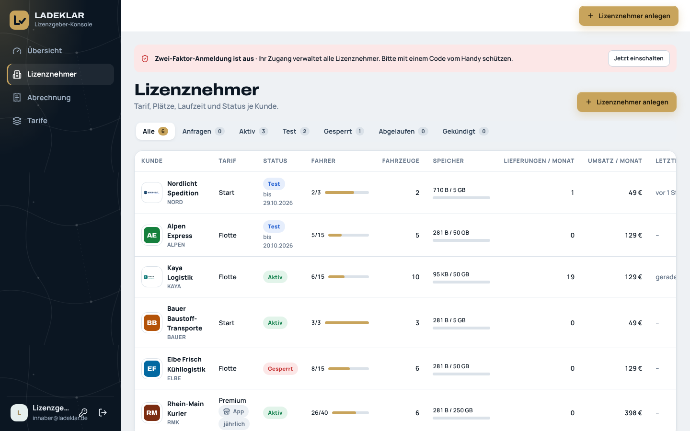
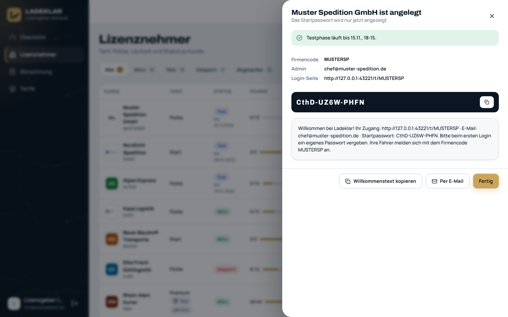
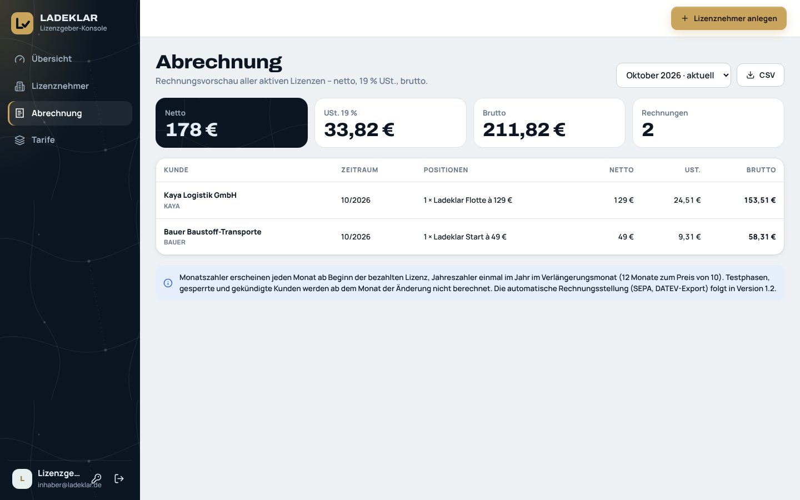
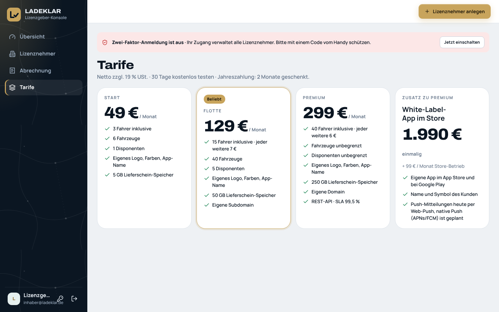

# Ladeklar – Handbuch für den Lizenzgeber

Für den Plattformbetreiber · Stand 16.10.2026 · Ladeklar Version 1.0

Als Lizenzgeber vermieten Sie Ladeklar an Speditionen und Transportunternehmen (Lizenznehmer). In der **Lizenzgeber-Konsole** legen Sie Kunden an, verwalten Tarif, Plätze und Status und sehen Ihren Umsatz. Die Lieferdaten Ihrer Kunden sehen Sie bewusst nicht. Dieses Handbuch beschreibt die Konsole, den Betrieb des Servers und den Start eines neuen Kunden.

## Inhalt

1. [Anmelden](#1-anmelden)
2. [Die Konsole: Übersicht](#2-die-konsole-übersicht)
3. [Lizenznehmer anlegen](#3-lizenznehmer-anlegen)
4. [Lizenz ändern](#4-lizenz-ändern)
5. [Status: Aktivieren, Test verlängern, Sperren, Kündigen](#5-status-aktivieren-test-verlängern-sperren-kündigen)
6. [Abrechnung](#6-abrechnung)
7. [Tarife](#7-tarife)
8. [Die Datenschutz-Grenze](#8-die-datenschutz-grenze)
9. [Betrieb des Servers](#9-betrieb-des-servers)
10. [Checkliste für den Kundenstart](#10-checkliste-für-den-kundenstart)
11. [Häufige Fragen](#11-häufige-fragen)

---

## 1. Anmelden

1. Öffnen Sie die Adresse Ihres Ladeklar-Servers.
2. Wählen Sie den Reiter **Büro / Disposition**.
3. Geben Sie die **E-Mail** und das **Passwort** Ihres Lizenzgeber-Zugangs ein und klicken Sie auf **Anmelden**.

Den Lizenzgeber-Zugang legen Sie einmalig auf dem Server an (siehe [Abschnitt 9](#den-lizenzgeber-zugang-anlegen)). Sie bleiben 14 Tage angemeldet, solange Sie die Konsole nutzen. Nach fünf falschen Passwörtern ist der Zugang 15 Minuten gesperrt. Abmelden: Pfeil-Symbol unten links neben Ihrem Namen.

In der Seitenleiste finden Sie **Übersicht**, **Lizenznehmer**, **Abrechnung** und **Tarife**. Der Knopf **Lizenznehmer anlegen** steht oben rechts auf jeder Seite.

---

## 2. Die Konsole: Übersicht


### Umsatz (MRR und ARR)

| Anzeige | Bedeutung |
|---|---|
| **Monatlich wiederkehrender Umsatz (MRR, netto)** | Summe der Monatspreise aller **aktiven** Lizenzen: Tarifpreis + zusätzliche Fahrer + ggf. Store-App (99 €). Jahreszahler zählen mit 10/12 ihres Monatspreises (2 Monate geschenkt). Testphasen, gesperrte, abgelaufene und gekündigte Lizenzen zählen nicht. |
| **ARR** | MRR × 12 |
| **aktive Lizenzen** | Lizenznehmer mit Status „Aktiv“ |
| **in der Testphase** | Lizenznehmer mit laufender Testphase |
| **Fahrer auf der Plattform** | aktive Fahrer aller Lizenznehmer zusammen |
| Balken | Verteilung der Lizenznehmer auf Start, Flotte und Premium (ohne gekündigte) und die Zahl der Lieferungen diesen Monat |

### Kacheln

| Kachel | Zählt |
|---|---|
| **Lizenznehmer gesamt** | alle angelegten Lizenznehmer |
| **Lieferungen im Monat** | im laufenden Monat angelegte Lieferungen aller Kunden (nur die Zahl) |
| **Test endet in 7 Tagen** | Testphasen, die in den nächsten 7 Tagen enden |
| **gesperrt** | Lizenznehmer mit Status „Gesperrt“ |

Darunter folgen:

- **Jetzt nachfassen: Test endet bald** – Kunden, deren Test in den nächsten 7 Tagen endet, mit Datum und **Öffnen**. Rufen Sie diese Kunden an, bevor der Test abläuft.
- **Neueste Lizenznehmer** – die fünf zuletzt angelegten Kunden mit Tarif, Monatspreis, letzter Aktivität, belegten Fahrer-Plätzen und Status. **Alle** öffnet die vollständige Liste.
- ein Hinweis zum Datenschutz: Sie sehen Nutzungszahlen, aber keine Lieferungen, Lieferscheine oder Fahrerdaten.

### Lizenznehmer-Liste



Unter **Lizenznehmer** sehen Sie alle Kunden als Tabelle. Oben filtern Sie nach **Alle**, **Aktiv**, **Test**, **Gesperrt** und **Abgelaufen** (mit Anzahl).

| Spalte | Inhalt |
|---|---|
| **Kunde** | Logo, Name und Firmencode |
| **Tarif** | Start, Flotte oder Premium; „App“ bei gebuchter Store-App, „jährlich“ bei Jahreszahlung |
| **Status** | Test (mit Enddatum), Aktiv, Gesperrt, Abgelaufen, Gekündigt |
| **Fahrer** | aktive Fahrer / Fahrer-Plätze, mit Balken |
| **Fahrzeuge** | Fahrzeuge im Pool |
| **Lieferungen / Monat** | im laufenden Monat angelegte Lieferungen |
| **Umsatz / Monat** | Monatspreis laut Lizenz |
| **Letzte Aktivität** | wann zuletzt eine Lieferung geändert wurde |

Ein Klick auf eine Zeile öffnet die Lizenz des Kunden (siehe [Abschnitt 4](#4-lizenz-ändern)).

> **Tipp:** Ein voller Fahrer-Balken (z. B. „3/3“) ist ein guter Anlass für ein Upgrade-Gespräch.

---

## 3. Lizenznehmer anlegen

1. Klicken Sie auf **Lizenznehmer anlegen**.
2. Füllen Sie das Formular aus (Tabelle unten).
3. Klicken Sie auf **Anlegen**.


| Feld | Hinweise |
|---|---|
| **Firmenname \*** | Pflicht. Aus dem Namen wird ein Firmencode vorgeschlagen. |
| **Firmencode (Login der Fahrer)** | Leer lassen übernimmt den Vorschlag (bis 8 Zeichen aus dem Firmennamen). Eigene Eingabe: 3–12 Buchstaben oder Ziffern, wird großgeschrieben. Muss eindeutig sein und lässt sich später in der Konsole nicht ändern. |
| **Präfix Buchungsnummer** | bis 6 Zeichen, z. B. „MUS“ für `MUS-2610-0001`. Leer: die ersten drei Zeichen des Firmencodes. Der Kunde kann es später selbst ändern. |
| **Ansprechpartner** | wird auch der Name des Admin-Zugangs |
| **Telefon** | Kontakt beim Kunden |
| **E-Mail für den Admin-Zugang \*** | Pflicht; damit meldet sich der Kunde an. Jede E-Mail kann nur einen Zugang haben. |
| **Anschrift** | Rechnungs- und Kontaktanschrift |
| **Tarif** | Start, Flotte (vorausgewählt) oder Premium |
| **Testphase (Tage, 0 = sofort aktiv)** | Voreinstellung 30 Tage, höchstens 365. Mit 0 ist die Lizenz sofort aktiv und wird berechnet. |
| **Zahlweise** | monatlich oder jährlich (2 Monate geschenkt) |
| **Markenfarbe** | Startfarbe der App; der Kunde kann sie später ändern und sein Logo selbst hochladen |

### Zugang und Willkommenstext

Nach dem Anlegen öffnet sich das Fenster **„… ist angelegt“**:



- Ein grüner Hinweis zeigt „Testphase läuft bis …“ oder „Lizenz ist aktiv.“
- **Firmencode**, **Admin** (E-Mail) und **Login-Seite** – die Adresse `…/t/FIRMENCODE` zeigt die Anmeldeseite im Branding des Kunden.
- das **Startpasswort** mit Kopier-Knopf. **Das Startpasswort wird nur jetzt angezeigt.**
- der **Willkommenstext**: „Willkommen bei Ladeklar! Ihr Zugang: … · E-Mail: … · Startpasswort: …. Bitte beim ersten Login ein eigenes Passwort vergeben. Ihre Fahrer melden sich mit dem Firmencode … an.“

Mit **Willkommenstext kopieren** übernehmen Sie den Text in die Zwischenablage, **Per E-Mail** öffnet Ihr E-Mail-Programm mit dem Betreff „Ihr Ladeklar-Zugang“ und dem fertigen Text. **Fertig** schließt das Fenster.

> **Wichtig:** Schicken Sie den Willkommenstext, bevor Sie auf **Fertig** klicken – das Startpasswort lässt sich danach in der Konsole nicht mehr anzeigen. Am sichersten übergeben Sie das Passwort auf einem zweiten Weg (z. B. telefonisch) und bitten den Kunden, es beim ersten Anmelden unter **Einstellungen → Mein Konto** zu ändern.

---

## 4. Lizenz ändern

Klicken Sie unter **Lizenznehmer** (oder in der Übersicht) auf einen Kunden.


Oben sehen Sie Name, Firmencode, „Kunde seit …“, Status, Tarif und den aktuellen Monatspreis. Die Kacheln zeigen die Nutzung: **Fahrer** (aktiv / Plätze), **Fahrzeuge**, **Lieferungen / Monat** und **Büro-Zugänge**.

Im Bereich **Lizenz** ändern Sie:

| Feld | Wirkung |
|---|---|
| **Tarif** | Start, Flotte oder Premium. Ändert Preis, Fahrer-Plätze, Fahrzeug- und Disponenten-Grenzen und den Zugang zur REST-API sofort. |
| **Zusätzliche Fahrer** | weitere Fahrer-Plätze über den Tarif hinaus: 7 € je Fahrer in Flotte, 6 € in Premium. Im Tarif Start gibt es keine Zusatzfahrer – dort wirkt das Feld nicht. |
| **Zahlweise** | monatlich oder jährlich |
| **White-Label-App im Store** | Zusatz mit eigener App des Kunden im App Store und bei Google Play: +99 € im Monat (einmalig 1.990 € stellen Sie separat in Rechnung) |
| **Interne Notiz** | nur für Sie, z. B. Vertragsnummer oder Absprachen |

Klicken Sie auf **Lizenz speichern**. Oben erscheint „Lizenz gespeichert · … / Monat“ mit dem neuen Monatspreis. Der Kunde sieht den neuen Tarif sofort unter **Einstellungen → Lizenz**.

> **Wichtig:** Beim Wechsel in einen kleineren Tarif bleiben bestehende Fahrer und Fahrzeuge erhalten, auch wenn sie über der neuen Grenze liegen. Der Kunde kann dann aber keine weiteren anlegen, bis er unter der Grenze liegt.

Ganz unten unter **Kontakt** stehen Ansprechpartner, E-Mail, Telefon und Anschrift aus der Anlage.

---

## 5. Status: Aktivieren, Test verlängern, Sperren, Kündigen

Im Bereich **Status** der Lizenz stehen – je nach aktuellem Status – diese Knöpfe:

| Knopf | Erscheint, wenn | Wirkung |
|---|---|---|
| **Aktivieren** | der Status nicht „Aktiv“ ist | Lizenz ist aktiv und wird ab sofort berechnet |
| **Test +14 Tage** | Test läuft oder ist abgelaufen | Status wird „Test“; das Testende wird um 14 Tage verschoben (ab dem bisherigen Testende bzw. ab heute, wenn es schon vorbei ist) |
| **Sperren** | der Status nicht „Gesperrt“ ist | Kunde kann nur noch lesen und exportieren; Fahrer können sich nicht anmelden |
| **Kündigen** | der Status nicht „Gekündigt“ ist | Zugang beendet |

Darunter erinnert die Konsole: „Gesperrt: Kunde kann Daten ansehen und exportieren, aber nichts ändern; Fahrer können sich nicht anmelden.“ Jede Änderung bestätigt „Status gespeichert“.

### Was der Status für Kunden und Fahrer bedeutet

| Status | Büro des Kunden | Fahrer | Abrechnung / MRR |
|---|---|---|---|
| **Test** | alle Funktionen; ab 10 Tagen vor Ende Hinweis „Testphase: noch … Tage“ | alle Funktionen | nicht berechnet |
| **Abgelaufen** (Testende vorbei, automatisch) | anmelden, ansehen und exportieren, aber nichts ändern | keine Anmeldung | nicht berechnet |
| **Aktiv** | alle Funktionen | alle Funktionen | berechnet |
| **Gesperrt** | anmelden, ansehen und exportieren, aber nichts ändern; Hinweis „Ihr Zugang ist gesperrt …“ | keine Anmeldung („Der Zugang ist zurzeit gesperrt. Bitte die Disposition anrufen.“); bereits angemeldete Fahrer können keine Schritte mehr senden | nicht berechnet |
| **Gekündigt** | keine Anmeldung mehr („Der Zugang dieses Unternehmens ist beendet.“); die Anmeldeseite `…/t/FIRMENCODE` zeigt kein Kunden-Branding mehr | keine Anmeldung | nicht berechnet |

Alle Statuswechsel lassen sich rückgängig machen – auch ein gekündigter Kunde kann mit **Aktivieren** wieder freigeschaltet werden. Die Daten bleiben in jedem Status gespeichert.

> **Wichtig:** Eine abgelaufene Testphase wird nicht automatisch zur bezahlten Lizenz. Sobald der Kunde bestellt hat, klicken Sie auf **Aktivieren**.

> **Wichtig:** Nach **Kündigen** kann sich der Kunde nicht mehr anmelden und damit auch nicht mehr selbst exportieren. Geben Sie ihm vorher Gelegenheit zum Datenexport – zum Beispiel, indem Sie die Lizenz zum Vertragsende zunächst **sperren** (Export bleibt möglich) und erst nach Ablauf des vereinbarten Abrufzeitraums **kündigen**.

---

## 6. Abrechnung

Unter **Abrechnung** sehen Sie eine Rechnungsvorschau aller aktiven Lizenzen – netto, 19 % USt. und brutto.



1. Wählen Sie oben rechts den **Monat** (die letzten sechs Monate).
2. Prüfen Sie die Kacheln **Netto**, **USt. 19 %**, **Brutto** und **Rechnungen**.
3. Prüfen Sie die Tabelle: **Kunde** (mit Firmencode), **Zeitraum**, **Positionen** (z. B. „1 × Ladeklar Flotte à 129 €“, „Zusätzliche Fahrer“, „White-Label-App (Store-Betrieb)“), **Netto**, **USt.**, **Brutto**.
4. Klicken Sie auf **CSV**, um die Liste herunterzuladen. Die Datei hat die Spalten Monat, Kunde, Code, Zahlweise, Positionen, Netto €, USt 19 % €, Brutto € (Semikolon getrennt, Beträge mit Komma) und lässt sich direkt in Excel oder Ihre Buchhaltung übernehmen.
5. Schreiben Sie die Rechnungen mit Ihrem Rechnungsprogramm.

Gut zu wissen:

- Berechnet werden nur Lizenzen mit Status **Aktiv**. Testphasen, gesperrte, abgelaufene und gekündigte Kunden stehen nicht in der Liste.
- Die Vorschau rechnet immer mit dem **heutigen** Stand von Tarif und Status – auch wenn Sie einen vergangenen Monat wählen. Erstellen Sie die Rechnungen deshalb zeitnah zum Monatswechsel.
- **Jahreszahler** stehen mit dem Vermerk „(Jahr)“ und dem Jahresbetrag (12 Monate zum Preis von 10) in der Liste – in jeder Monatsansicht. Stellen Sie ihnen nur einmal im Jahr eine Rechnung.
- Die einmalige Einrichtung der Store-App (1.990 €) erscheint nicht in der Vorschau.
- Automatische Rechnungsstellung mit SEPA-Lastschrift und DATEV-Export: geplant (Roadmap, Version 1.2).

---

## 7. Tarife

Unter **Tarife** sehen Sie die Tarife so, wie sie Ihre Kunden kennen. Alle Preise netto zzgl. 19 % USt.



| | **Start** | **Flotte** | **Premium** |
|---|---|---|---|
| Preis je Monat | 49 € | 129 € | 299 € |
| Fahrer inklusive | 3 | 15 | 40 |
| jeder weitere Fahrer | – | 7 € | 6 € |
| Fahrzeuge | 6 | 40 | unbegrenzt |
| Disponenten (zusätzlich zum Admin) | 1 | 5 | unbegrenzt |
| Lieferschein-Speicher | 5 GB | 50 GB | 250 GB |
| Eigenes Logo, Farben, App-Name | ja | ja | ja |
| Domain | – | eigene Subdomain | eigene Domain |
| REST-API, SLA 99,5 % | – | – | ja |

**Zusatz zu Premium – White-Label-App im Store:** 1.990 € einmalig + 99 € je Monat Store-Betrieb; eigene App im App Store und bei Google Play mit Name und Symbol des Kunden, Push über APNs/FCM.

30 Tage kostenlos testen; Jahreszahlung: 2 Monate geschenkt. Ladeklar richtet sich nur an Unternehmer (§ 14 BGB).

Die Tarife sind in der Software fest hinterlegt und in der Konsole nicht änderbar. Neue Preise oder Grenzen kommen mit einem Software-Update.

---

## 8. Die Datenschutz-Grenze

Rechtlich sind Sie für Ihre Kunden **Auftragsverarbeiter** (Art. 28 DSGVO); jeder Lizenznehmer ist für seine Daten selbst verantwortlich. Ladeklar setzt das technisch um:

| Sie sehen in der Konsole | Sie sehen nicht |
|---|---|
| Name, Firmencode, Logo, Kontaktdaten des Kunden | Lieferungen, Routen, Auftraggeber |
| Tarif, Status, Zahlweise, Preise | Lieferscheine, Fotos, Unterschriften |
| Anzahl aktiver Fahrer, Fahrzeuge, Büro-Zugänge | Namen und Telefonnummern der Fahrer |
| Anzahl Lieferungen im Monat, letzte Aktivität | Notizen, Problemmeldungen, Standorte |

### Support nur mit Freigabe des Kunden

Braucht ein Kunde Hilfe mit seinen Daten, gibt **er** unter **Einstellungen → Daten & Datenschutz → Support-Zugriff** mit **Für 24 Stunden freigeben** einen befristeten Zugriff frei. Die Freigabe und ihr Ende stehen im Protokoll des Kunden; er kann sie mit **Jetzt beenden** jederzeit zurücknehmen.

Die Konsole hat in Version 1.0 keinen eigenen Einstieg in die Daten eines Kunden. Helfen Sie gemeinsam mit dem Kunden, während er seine Ladeklar-Seite vor sich hat, und arbeiten Sie nur im Rahmen einer erteilten Freigabe.

### Daten auf dem Server

Technisch liegen alle Daten im Ordner `data/` Ihres Servers (siehe [Abschnitt 9](#datensicherung)). Zugriff darauf ist nur für Betrieb, Datensicherung und Wiederherstellung vorgesehen – so, wie es der Auftragsverarbeitungsvertrag (AVV) und die technisch-organisatorischen Maßnahmen (TOM) beschreiben. Passwörter und PINs sind nur als scrypt-Hash gespeichert.

- Die Löschfristen der Kunden setzt der Server automatisch um (stündlich): abgeschlossene Lieferungen samt Dateien nach der vom Kunden gewählten Aufbewahrung (1–10 Jahre), Standorte und Mitteilungen nach 90 Tagen, Protokolle nach 3 Jahren.
- Eine Funktion zum vollständigen Löschen eines Lizenznehmers nach Vertragsende gibt es in der Konsole in Version 1.0 nicht. Planen Sie die Löschung nach § 11 AVV als technischen Vorgang auf dem Server ein.

Die Vertragsmuster (AGB, AVV, TOM, Liste der Unterauftragsverarbeiter, Leistungsbeschreibung und SLA, Datenschutzhinweise für Fahrer, Muster-Betriebsvereinbarung) liegen im Ordner `docs/recht/`. Lassen Sie sie vor der Verwendung anwaltlich prüfen.

---

## 9. Betrieb des Servers

### Voraussetzungen

- Node.js ab Version 22.5 (der Server nutzt das eingebaute SQLite von Node.js; weitere Pakete braucht er im Betrieb nicht)
- ein Server, idealerweise in Deutschland bzw. der EU
- eine Domain mit HTTPS-Zertifikat. Ohne HTTPS funktionieren Push-Mitteilungen und die Installation der App auf dem Handy nicht.

### Server starten

Im Hauptordner von Ladeklar:

```bash
npm start                 # startet den Server (gleichbedeutend: node server/index.js)
npm run dev               # startet mit Demo-Daten – nur bei leerer Datenbank, nur zum Ausprobieren
```

Beim Start erscheint „LADEKLAR 1.0.0 läuft auf http://localhost:8080“. Gibt es noch keinen Lizenzgeber-Zugang, weist der Server darauf hin.

Einstellungen über Umgebungsvariablen:

| Variable | Bedeutung | Voreinstellung |
|---|---|---|
| `PORT` | Port des Servers | `8080` |
| `HOST` | Netzwerkadresse | `0.0.0.0` |
| `DATA_DIR` | Ordner für Datenbank und Dateien | `data/` im Hauptordner |
| `BASE_URL` | öffentliche Adresse, z. B. `https://app.ladeklar.de`. Mit `https://` werden sichere Cookies und HSTS aktiv. | leer |
| `TRUST_PROXY` | `1`, wenn der Server hinter einem Reverse Proxy läuft (echte IP für die Anmelde-Sperre) | aus |
| `PUSH_SUBJECT` | Kontakt für Push-Dienste, z. B. `mailto:support@ihre-firma.de` | `mailto:support@ladeklar.de` |
| `PLATFORM_EMAIL`, `PLATFORM_PASSWORD` | legt beim Start den Lizenzgeber-Zugang an, falls noch keiner existiert | – |
| `SECURITY_CONTACT` | E-Mail für `/.well-known/security.txt` | `security@ladeklar.de` |

Ob der Server läuft, prüfen Sie unter `/api/health` – die Antwort enthält `ok` und die Versionsnummer.

### Den Lizenzgeber-Zugang anlegen

Einmalig, bei gestopptem Server:

```bash
node server/index.js setup <email> <passwort>
```

Optional als drittes Argument ein Anzeigename. Das Passwort braucht mindestens 10 Zeichen. Bei Erfolg erscheint „Lizenzgeber-Zugang angelegt: …“. Der Befehl funktioniert nur, solange es noch keinen Lizenzgeber-Zugang gibt („Es gibt schon einen Lizenzgeber-Zugang.“).

> **Wichtig:** Wählen Sie gleich ein starkes Passwort und bewahren Sie es sicher auf. Die Konsole hat in Version 1.0 keine eigene Seite zum Ändern des Passworts, und es gibt genau einen Lizenzgeber-Zugang.

### Reverse Proxy und Domains

- Betreiben Sie den Server hinter einem Reverse Proxy mit HTTPS (z. B. nginx oder Caddy) und setzen Sie `TRUST_PROXY=1` und `BASE_URL`.
- Live-Updates laufen über eine dauerhaft offene Verbindung (`/api/events`). Der Proxy darf sie nicht puffern oder nach kurzer Zeit schließen.
- Kunden-Subdomains der Form `firmencode.ladeklar.de` (oder `.app`) erkennt der Server automatisch und zeigt dort die Anmeldeseite im Branding des Kunden. Dafür brauchen Sie einen Wildcard-DNS-Eintrag und ein passendes Zertifikat. Ohne Subdomain funktioniert immer die Adresse `…/t/FIRMENCODE`.

### Push-Schlüssel (VAPID)

Die Schlüssel für Web-Push erzeugt der Server beim ersten Start automatisch und speichert sie in der Datenbank. Sie müssen nichts einrichten. Löschen Sie die Datenbank nicht und tauschen Sie die Schlüssel nicht aus – sonst müssen alle Nutzer die Mitteilungen neu einschalten.

### Datensicherung

Alles, was gesichert werden muss, liegt im Ordner `data/` (bzw. `DATA_DIR`):

| Inhalt | Datei |
|---|---|
| Datenbank: Lizenznehmer, Nutzer, Fahrzeuge, Lieferungen, Mitteilungen, Protokoll, Sitzungen, Push-Abos, Push-Schlüssel | `ladeklar.db` (dazu im Betrieb `ladeklar.db-wal` und `ladeklar.db-shm`) |
| Lieferscheine, Fotos, Unterschriften, Logos | `files/<Kunden-ID>/…` |

So sichern Sie:

1. Server kurz stoppen.
2. Den ganzen Ordner `data/` kopieren – immer alle drei `ladeklar.db*`-Dateien zusammen mit dem Ordner `files/`.
3. Server wieder starten.

Speichern Sie die Sicherungen verschlüsselt und an einem zweiten Ort in der EU, und löschen Sie alte Sicherungen nach der im AVV genannten Frist (Muster: 30 Tage). Wiederherstellen: Server stoppen, Ordner `data/` durch die Sicherung ersetzen, Server starten.

### Updates

1. Datensicherung machen (siehe oben).
2. Server stoppen.
3. Neue Programmversion in den Hauptordner übernehmen (z. B. `git pull`). Der Ordner `data/` bleibt unverändert.
4. Server starten. Fehlende Tabellen legt der Server beim Start selbst an.
5. Unter `/api/health` die neue Versionsnummer prüfen.

### Was der Server selbst erledigt

- **stündlich:** Löschfristen umsetzen und abgelaufene Sitzungen entfernen
- **Anmelde-Schutz:** höchstens 20 Anmeldeversuche pro Minute und IP-Adresse; nach fünf falschen Passwörtern bzw. PINs ist der einzelne Zugang 15 Minuten gesperrt
- **REST-API:** höchstens 600 Anfragen pro Minute und Kunde
- **Sitzungen:** Fahrer bleiben 90 Tage angemeldet, Büro und Lizenzgeber 14 Tage (jeweils verlängert bei Nutzung)
- **Uploads:** nur JPG, PNG, WebP und PDF; der Dateiinhalt wird geprüft

---

## 10. Checkliste für den Kundenstart

**Vertrag**

- [ ] SaaS-Lizenzvertrag (AGB) mit Leistungsbeschreibung und SLA abgeschlossen – nur mit Unternehmern (§ 14 BGB)
- [ ] Auftragsverarbeitungsvertrag (AVV) unterschrieben; TOM und Liste der Unterauftragsverarbeiter übergeben
- [ ] Tarif, Zahlweise und Testphase vereinbart

**Zugang**

- [ ] Lizenznehmer in der Konsole angelegt (Firmencode, Präfix, Tarif, Testphase, Farbe)
- [ ] Willkommenstext verschickt, Startpasswort möglichst auf zweitem Weg übergeben
- [ ] Kunde hat sich angemeldet und ein eigenes Passwort vergeben
- [ ] Empfehlung gegeben, einen zweiten Admin anzulegen (falls ein Passwort verloren geht)

**Schulung (15 Minuten, am besten am Bildschirm des Kunden)**

| Minute | Inhalt |
|---|---|
| 0–3 | Anmelden, Passwort ändern, Logo und Farbe unter **Firma & Marke** |
| 3–6 | **Abläufe** gemeinsam durchgehen: Fahrzeugwahl, offene Aufträge, Lieferschein-Pflicht, Ankunft-Erfassung, Palettentausch; Hinweis auf Datenschutz bei Standort und Auswertungen je Fahrer |
| 6–9 | ein Fahrzeug anlegen, einen Fahrer anlegen und die Einladung per WhatsApp an das eigene Handy schicken |
| 9–13 | eine Lieferung anlegen und auf dem Handy einmal komplett durchtippen: LKW wählen, Buchung bestätigen, Aufgeladen, Abgeladen, Lieferschein fotografieren, Bestätigen & abschließen – dabei im Büro die Live-Übersicht beobachten |
| 13–15 | Abliefernachweis drucken, Datenexport und Support-Freigabe zeigen, Fragen klären |

**Fahrer**

- [ ] [Fahrer-Kurzanleitung](FAHRER_KURZANLEITUNG.md) in den Sprachen der Fahrer ausgedruckt (PDF-Fassung: `node tools/build-docs.js`)
- [ ] Kunde informiert seine Fahrer mit den Datenschutzhinweisen für Fahrer und den Nutzungsbedingungen der Fahrer-App (Vorlagen in `docs/recht/`)
- [ ] Bei Standort-Speicherung oder Auswertungen je Fahrer: Betriebsrat einbezogen, ggf. Muster-Betriebsvereinbarung genutzt

**Übergabe**

- [ ] [Handbuch für Unternehmen](HANDBUCH_UNTERNEHMEN.md) an den Kunden geschickt
- [ ] Wiedervorlage zum Testende eingetragen (Kachel **Test endet in 7 Tagen**); nach der Bestellung **Aktivieren**

---

## 11. Häufige Fragen

**Ein Kunde hat sein Admin-Passwort vergessen.**
Hat der Kunde einen zweiten Admin, erzeugt dieser unter **Einstellungen → Team → Neues Passwort** ein neues. Die Konsole hat in Version 1.0 keine Funktion zum Zurücksetzen von Kunden-Passwörtern – empfehlen Sie deshalb jedem Kunden einen zweiten Admin.

**Ein Kunde braucht mehr Fahrer.**
Öffnen Sie seine Lizenz und erhöhen Sie **Zusätzliche Fahrer** (Flotte und Premium) oder wählen Sie einen größeren **Tarif**. Dann **Lizenz speichern** – die Plätze stehen sofort zur Verfügung.

**Der Test läuft ab, der Kunde braucht noch Zeit.**
Öffnen Sie die Lizenz und klicken Sie auf **Test +14 Tage**. Das geht auch, wenn der Test schon abgelaufen ist.

**Ein Kunde zahlt nicht.**
Klicken Sie auf **Sperren**. Der Kunde kann seine Daten weiter ansehen und exportieren, aber nichts ändern; seine Fahrer können sich nicht anmelden. Nach Zahlungseingang klicken Sie auf **Aktivieren**.

**Ein Kunde kündigt.**
Geben Sie ihm Zeit für den Datenexport (Lizenz gegebenenfalls zunächst sperren), klicken Sie danach auf **Kündigen** und planen Sie die Löschung der Daten nach § 11 AVV.

**Ein Kunde möchte seinen Firmencode ändern.**
Der Firmencode lässt sich in der Konsole nach dem Anlegen nicht ändern. Das Präfix der Buchungsnummer kann der Kunde unter **Einstellungen → Abläufe** selbst ändern.

**Ich möchte mir die Lieferungen eines Kunden ansehen.**
Das ist in der Konsole bewusst nicht möglich (siehe [Abschnitt 8](#8-die-datenschutz-grenze)).
