# Ladeklar – Handbuch für Unternehmen

Für Inhaber, Unternehmens-Admins und Disponenten · Stand 16.10.2026 · Ladeklar Version 1.0

Die Bildschirmfotos zeigen die Beispielfirma „Kaya Logistik“. In Ihrer App sehen Sie stattdessen Ihr eigenes Logo, Ihre Farbe und Ihren App-Namen.

## Inhalt

1. [Willkommen](#1-willkommen)
2. [Die ersten 10 Minuten](#2-die-ersten-10-minuten)
3. [Die Live-Übersicht lesen](#3-die-live-übersicht-lesen)
4. [Lieferungen anlegen, zuweisen und pflegen](#4-lieferungen-anlegen-zuweisen-und-pflegen)
5. [Den Fortschritt verstehen](#5-den-fortschritt-verstehen)
6. [Lieferschein, Fotos, Unterschrift und Abliefernachweis](#6-lieferschein-fotos-unterschrift-und-abliefernachweis)
7. [Störungen und Notizen](#7-störungen-und-notizen)
8. [Für Fahrer setzen – wenn ein Fahrer anruft](#8-für-fahrer-setzen--wenn-ein-fahrer-anruft)
9. [Fahrer verwalten](#9-fahrer-verwalten)
10. [Der Fahrzeug-Pool](#10-der-fahrzeug-pool)
11. [Berichte](#11-berichte)
12. [Einstellungen](#12-einstellungen)
13. [Mitteilungen und Push](#13-mitteilungen-und-push)
14. [Datenexport und Anbieterwechsel](#14-datenexport-und-anbieterwechsel)
15. [Lizenz und Tarif](#15-lizenz-und-tarif)
16. [Häufige Fragen](#16-häufige-fragen)
17. [Glossar](#17-glossar)

---

## 1. Willkommen

Ladeklar nimmt Ihrer Disposition die Telefonate ab, mit denen Sie bisher hinter jeder Tour hergelaufen sind. Ihre Fahrer bestätigen jeden Schritt – Buchung, Aufgeladen, Abgeladen, Zugestellt – mit einem einzigen Tipp, und Sie sehen es im selben Moment. Der Lieferschein kommt als Foto ins Büro, sobald der Fahrer abschließt, und wird mit allen Zeitstempeln zum druckbaren Abliefernachweis. Störungen wie Panne, Stau oder verweigerte Annahme erreichen Sie sofort als dringende Mitteilung, und Standzeiten, Pünktlichkeit und Palettentausch werden nebenbei erfasst. Die App trägt Ihr Logo, Ihre Farbe und Ihren App-Namen, und Ihre Fahrer bedienen sie mit großen Knöpfen in acht Sprachen.

### Wer darf was?

| Rolle | Darf | Sieht in den Einstellungen |
|---|---|---|
| **Admin** (Inhaber, Leitung) | alles im eigenen Unternehmen: Lieferungen, Fahrer, Fahrzeuge, Berichte, Logo und Farbe, Abläufe, Büro-Zugänge, Datenexport, Support-Freigabe, API | alle Reiter |
| **Disponent** | Lieferungen anlegen, ändern, zuweisen und stornieren; Fahrer anlegen, bearbeiten, sperren und neue PIN vergeben; Fahrzeuge anlegen, bearbeiten und freigeben; Berichte; Lieferungen als CSV herunterladen | nur „Mein Konto“ und „Berichte“ |
| **Fahrer** | eigene Touren und freie Aufträge sehen, Schritte bestätigen, Lieferschein fotografieren, Notizen und Probleme melden | – (eigene Fahrer-App, siehe [Fahrer-Kurzanleitung](FAHRER_KURZANLEITUNG.md)) |

Ihre Daten sind von allen anderen Unternehmen auf der Plattform getrennt. Auch der Anbieter von Ladeklar sieht Ihre Lieferungen, Lieferscheine und Fahrerdaten nicht.

---

## 2. Die ersten 10 Minuten

Arbeiten Sie diese Liste einmal von oben nach unten ab. Danach kann die erste Tour laufen.

- [ ] 1. Anmelden und eigenes Passwort vergeben
- [ ] 2. Logo und Farbe hochladen
- [ ] 3. Abläufe wählen
- [ ] 4. Fahrzeuge anlegen
- [ ] 5. Fahrer anlegen und einladen
- [ ] 6. Erste Lieferung anlegen

### Schritt 1: Anmelden und Passwort ändern

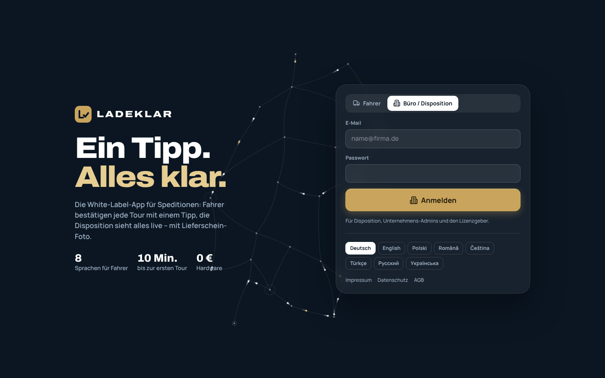

1. Öffnen Sie den Link aus der Willkommens-Nachricht Ihres Anbieters.
2. Wählen Sie den Reiter **Büro / Disposition**.
3. Geben Sie Ihre **E-Mail** und das **Startpasswort** ein und klicken Sie auf **Anmelden**.
4. Gehen Sie zu **Einstellungen → Mein Konto**.
5. Tragen Sie unter **Aktuelles Passwort** das Startpasswort ein und unter **Neues Passwort (mind. 10 Zeichen)** Ihr eigenes Passwort.
6. Klicken Sie auf **Passwort ändern**.

> **Wichtig:** Solange Sie das Startpasswort noch nicht geändert haben, zeigt „Mein Konto“ den Hinweis „Bitte vergeben Sie jetzt ein eigenes Passwort.“ Erledigen Sie das gleich beim ersten Mal – das Startpasswort stand in einer E-Mail.

> **Tipp:** Nach fünf falschen Passwörtern ist der Zugang für 15 Minuten gesperrt. Im Büro bleiben Sie 14 Tage angemeldet, solange Sie die App regelmäßig nutzen.

### Schritt 2: Logo und Farbe

1. Gehen Sie zu **Einstellungen → Firma & Marke**.
2. Klicken Sie auf **Logo hochladen** und wählen Sie Ihr Logo (PNG, JPG, WebP oder SVG). Das Logo wird sofort gespeichert; Ladeklar erzeugt daraus auch das Handy-Symbol.
3. Wählen Sie unter **Markenfarbe** eine der vorgeschlagenen Farben oder rechts im Farbfeld Ihre genaue Hausfarbe.
4. Prüfen Sie **App-Name (unter dem Handy-Symbol)**, **Firmenname**, **Telefon Disposition (für Fahrer)** und **Anschrift**.
5. Klicken Sie auf **Speichern**. Rechts sehen Sie die **Vorschau Fahrer-App**.

Details zu diesem Reiter finden Sie in [Abschnitt 12](#firma--marke).

### Schritt 3: Abläufe wählen

Unter **Einstellungen → Abläufe** legen Sie fest, wie Ihre Fahrer arbeiten: ob sie ihr Fahrzeug selbst wählen, ob der Lieferschein Pflicht ist, ob die Ankunft an der Rampe erfasst wird und einiges mehr. Für den Start sind die Voreinstellungen gut geeignet. Eine Erklärung jedes Schalters finden Sie in [Abschnitt 12](#abläufe).

### Schritt 4: Fahrzeuge anlegen

1. Klicken Sie links auf **Fahrzeuge** und dann auf **Fahrzeug anlegen**.
2. Wählen Sie oben **LKW / Zugmaschine** oder **Auflieger / Anhänger**.
3. Tragen Sie mindestens das **Kennzeichen** ein, dazu am besten **Art**, **Bezeichnung** und die Termine **Nächste HU** und **Nächste SP**.
4. Klicken Sie auf **Speichern**. Wiederholen Sie das für jedes Fahrzeug.

Mehr dazu in [Abschnitt 10](#10-der-fahrzeug-pool).

### Schritt 5: Fahrer einladen

1. Klicken Sie links auf **Fahrer** und dann auf **Fahrer anlegen**.
2. Tragen Sie **Name** und **Handynummer** ein und wählen Sie die **Sprache der App**.
3. Klicken Sie auf **Anlegen & PIN erzeugen**.
4. Schicken Sie die Einladung mit **WhatsApp** oder **SMS** – oder lassen Sie den Fahrer den QR-Code mit der Handy-Kamera scannen.

Mehr dazu in [Abschnitt 9](#9-fahrer-verwalten).

### Schritt 6: Erste Lieferung

1. Klicken Sie oben rechts auf **Neue Lieferung**.
2. Tragen Sie Lade- und Entladeort (jeweils **Stadt**) und das Ladedatum ein.
3. Wählen Sie einen **Fahrer** oder lassen Sie „— offen für alle Fahrer —“ stehen.
4. Klicken Sie auf **Lieferung anlegen**.

Der Fahrer bekommt sofort eine Mitteilung. Mehr dazu in [Abschnitt 4](#4-lieferungen-anlegen-zuweisen-und-pflegen).

> **Tipp:** Schalten Sie auf der Live-Übersicht die Push-Mitteilungen ein (Hinweis „Push-Mitteilungen einschalten …“ → **Einschalten**). Dann hören Sie es, wenn der Fahrer bestätigt.

---

## 3. Die Live-Übersicht lesen

Nach der Anmeldung landen Sie auf **Live**. Hier sehen Sie auf einen Blick, was gerade auf der Straße passiert.

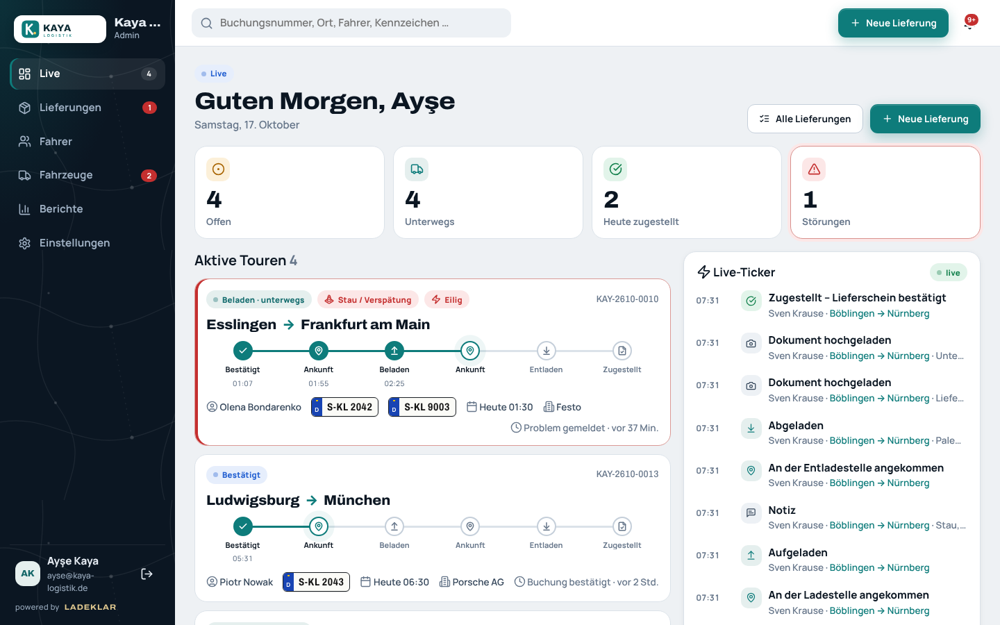

### Die vier Kacheln

| Kachel | Zählt | Ein Klick öffnet |
|---|---|---|
| **Offen** | alle Lieferungen, die noch kein Fahrer bestätigt hat | Lieferungen, Reiter „Offen“ |
| **Unterwegs** | alle bestätigten, noch nicht zugestellten Touren | Lieferungen, Reiter „Live“ |
| **Heute zugestellt** | heute abgeschlossene Lieferungen | Lieferungen, Reiter „Erledigt“ |
| **Störungen** | gemeldete Probleme, die noch niemand als erledigt markiert hat | Lieferungen, Reiter „Störungen“ |

Sobald es eine Störung gibt, ist die Kachel „Störungen“ rot umrandet.

### Aktive Touren

Unter den Kacheln steht jede laufende Tour als Karte. Touren mit Störung stehen oben, danach die mit der jüngsten Meldung. Eine Karte zeigt:

- **Status** (z. B. „Beladen · unterwegs“), dazu eine gemeldete Störung und „Eilig“, wenn gesetzt
- **Buchungsnummer** und **Route** (Ladeort → Entladeort)
- die **Fortschrittsleiste** mit der Uhrzeit jedes erledigten Schritts
- **Fahrer**, **Kennzeichen** von LKW und Auflieger, **Ladetermin** und **Auftraggeber**
- unten rechts die **letzte Meldung**, z. B. „Problem gemeldet · vor 37 Min.“

Ein Klick auf die Karte öffnet die Lieferung mit allen Details. Darunter folgt der Bereich **Heute offen** mit Lieferungen, deren Ladedatum heute (oder früher) ist und die noch niemand bestätigt hat.

### Live-Ticker

Rechts läuft der **Live-Ticker**: jede Meldung der letzten Tage mit Uhrzeit, Ereignis (z. B. „Aufgeladen“, „Dokument hochgeladen“, „Notiz“), Person und Route. Ein Klick auf die Route öffnet die Lieferung.

### Fuhrpark und Fristen

Unter dem Ticker zeigt die Karte **Fuhrpark**, wie viele Fahrzeuge **im Einsatz** sind, wie viele **Fahrer auf Tour** sind und wie viele Fahrzeuge in der **Werkstatt** stehen. Darunter erscheinen fällige Hauptuntersuchungen (HU) und Sicherheitsprüfungen (SP) – ab 30 Tage vor dem Termin („fällig am …“) und rot, wenn der Termin vorbei ist („überfällig seit …“). **Alle** öffnet die Fahrzeugliste.

### Zahlen in der Seitenleiste und Suche

- Neben **Live** steht die Zahl der laufenden Touren.
- Neben **Lieferungen** steht rot die Zahl der Störungen, sonst die Zahl der offenen Lieferungen.
- Neben **Fahrzeuge** steht rot die Zahl der Fahrzeuge mit fälliger HU oder SP.
- Das Suchfeld oben („Buchungsnummer, Ort, Fahrer, Kennzeichen …“) durchsucht alle Lieferungen.

### Auf dem Tablet und dem Handy

Die Disposition funktioniert auch auf dem Tablet. Auf dem Handy finden Sie die Bereiche in der Leiste unten: **Live**, **Lieferungen**, **Fahrer**, **Fahrzeuge** und **Mehr** (Einstellungen; die Berichte erreichen Sie dort über den Reiter **Berichte**).

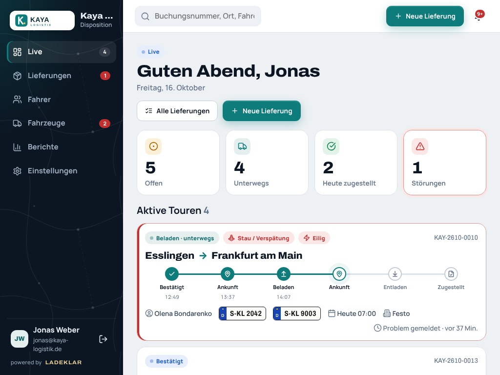

---

## 4. Lieferungen anlegen, zuweisen und pflegen

Unter **Lieferungen** finden Sie Gegenwart, Zukunft und Vergangenheit an einem Ort.

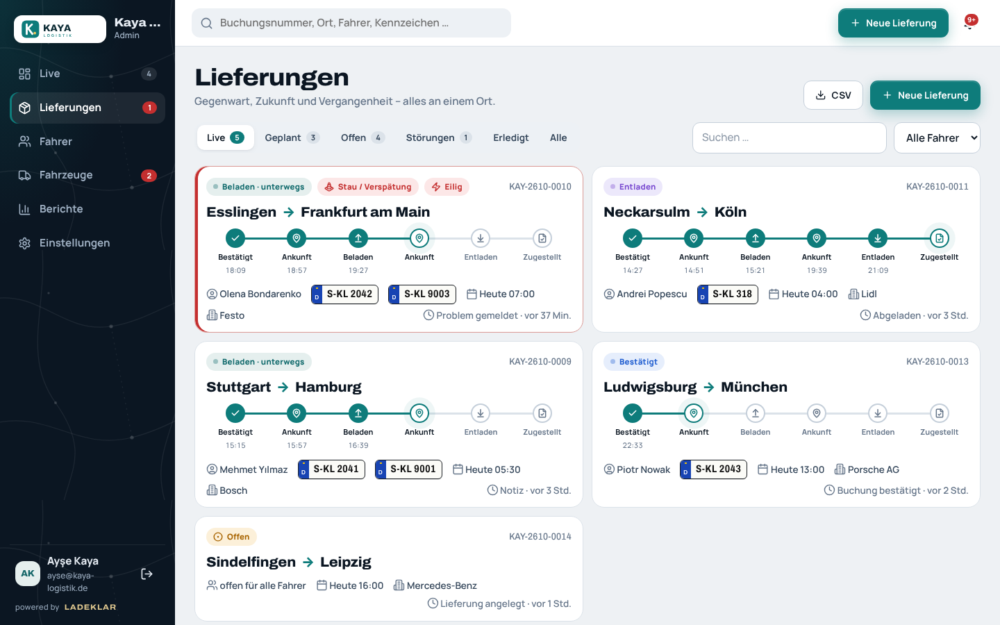

### Die Reiter

| Reiter | Zeigt |
|---|---|
| **Live** | alle laufenden Touren und alle offenen Lieferungen mit Ladedatum heute oder früher |
| **Geplant** | offene oder bestätigte Lieferungen mit Ladedatum in der Zukunft |
| **Offen** | alle Lieferungen, die noch kein Fahrer bestätigt hat |
| **Störungen** | Lieferungen mit gemeldetem, noch nicht erledigtem Problem |
| **Erledigt** | zugestellte und stornierte Lieferungen, neueste zuerst, als Tabelle |
| **Alle** | alle Lieferungen als Tabelle |

Rechts daneben können Sie **suchen** (Buchungsnummer, Auftraggeber, Referenz, Ort, Straße, Fahrer, Kennzeichen, Ware) und mit **Alle Fahrer** auf einen Fahrer filtern. **CSV** lädt die Lieferungen als Tabelle herunter (siehe [Abschnitt 14](#14-datenexport-und-anbieterwechsel)).

In den Reitern Live, Geplant, Offen und Störungen stehen Lieferungen mit Störung zuerst, dann eilige, dann nach Ladetermin.

Unter **Erledigt** und **Alle** sehen Sie eine Tabelle mit Buchung, Route und Auftraggeber, Ladetag, Fahrer, Fahrzeug, Status, Standzeit und ob ein Lieferschein „da“ ist. Ein Klick auf eine Zeile öffnet die Lieferung.

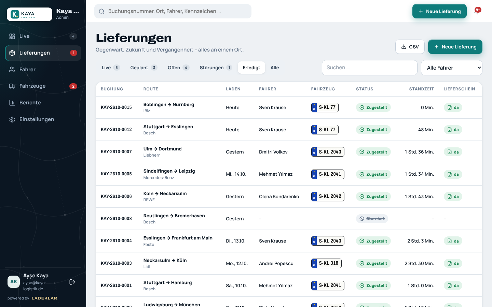

### Neue Lieferung anlegen

Klicken Sie auf **Neue Lieferung** (oben rechts – auf jeder Seite verfügbar).

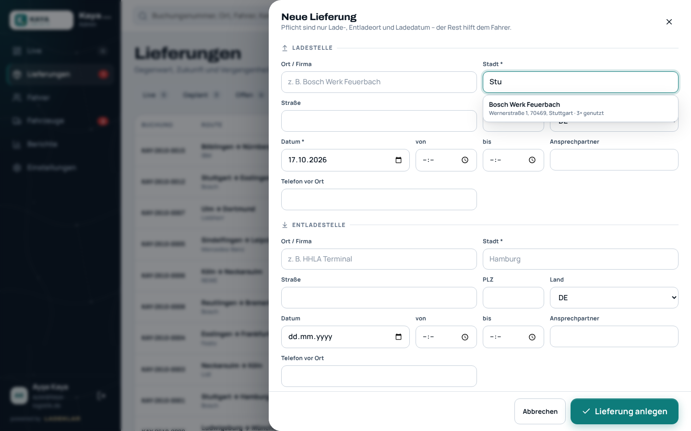

Pflicht sind nur die **Stadt** der Ladestelle, die **Stadt** der Entladestelle und das **Datum** der Ladestelle. Alles andere hilft dem Fahrer.

| Bereich | Felder |
|---|---|
| **Ladestelle** | Ort / Firma · **Stadt \*** · Straße · PLZ · Land · **Datum \*** · von · bis · Ansprechpartner · Telefon vor Ort |
| **Entladestelle** | Ort / Firma · **Stadt \*** · Straße · PLZ · Land · Datum · von · bis · Ansprechpartner · Telefon vor Ort |
| **Ware** | Beschreibung · Paletten · Gewicht (kg) · Temperatur · Gefahrgut (ADR) · Eilig |
| **Auftrag** | Auftraggeber · Referenz des Kunden |
| **Fahrer & Fahrzeug** | Fahrer · LKW (optional) · Auflieger (optional) |
| | Hinweise für den Fahrer · Interne Notiz (sieht der Fahrer nicht) |

Zum Schluss klicken Sie auf **Lieferung anlegen**. Oben rechts erscheint „Angelegt · KAY-2610-0019“ mit dem Hinweis, wer benachrichtigt wurde, und die neue Lieferung öffnet sich.

- **Land:** zur Auswahl stehen DE, AT, CH, NL, BE, FR, PL, CZ, IT, DK, LU, ES, RO und HU.
- **Entladedatum:** darf nicht vor dem Ladedatum liegen.
- **Telefon vor Ort:** Diese Nummer wählt der Fahrer mit dem Knopf „Anrufen“, solange er zu dieser Stelle unterwegs ist.
- **Hinweise für den Fahrer** erscheinen groß auf seiner Tour-Karte (z. B. „Gate B anmelden, Rampe 12“).
- **Eilig** markiert die Lieferung rot; die Mitteilung an den Fahrer kommt mit hoher Priorität.
- **LKW (optional):** Steht hier „Fahrer wählt selbst“, übernimmt die Lieferung das Fahrzeug, das der Fahrer in seiner App gewählt hat.

**Die Buchungsnummer** vergibt Ladeklar automatisch: Präfix – Jahr und Monat – laufende Nummer, z. B. `KAY-2610-0019` (Präfix KAY, Oktober 2026, Lieferung Nr. 19). Das Präfix stellen Sie unter **Einstellungen → Abläufe** ein.

### Orts-Vorschläge

Sobald Sie im Feld **Ort / Firma** oder **Stadt** zwei Buchstaben getippt haben, schlägt Ladeklar Orte vor, die Sie schon einmal verwendet haben – mit Adresse und „3× genutzt“. Ein Klick füllt Ort, Straße, PLZ, Stadt, Land, Ansprechpartner und Telefon aus. Ein eigenes Adressbuch brauchen Sie dafür nicht.

### Zuweisen oder „offen für alle“

Sie haben zwei Wege:

1. **Einem Fahrer zuweisen:** Wählen Sie im Feld **Fahrer** einen Namen. Der Fahrer bekommt die Mitteilung „Neuer Auftrag …“ und muss die Tour mit **Buchung bestätigen** annehmen.
2. **Offen für alle:** Lassen Sie „— offen für alle Fahrer —“ stehen. Alle aktiven Fahrer bekommen die Mitteilung „Offener Auftrag“ und sehen die Tour unter „Freie Aufträge“. Wer zuerst **Auftrag übernehmen** tippt, bekommt sie.

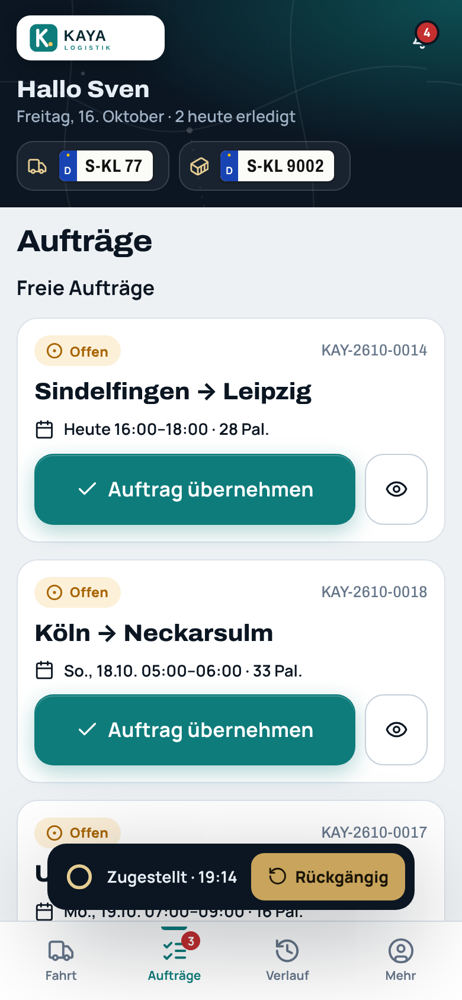

> **Wichtig:** „Offen für alle“ funktioniert nur, wenn unter **Einstellungen → Abläufe** der Schalter **Fahrer dürfen offene Aufträge übernehmen** an ist. Ist er aus, sehen die Fahrer offene Aufträge nicht – dann weisen Sie jede Lieferung selbst zu.

Später ändern Sie die Zuweisung in der geöffneten Lieferung im Bereich **Zuweisung**:

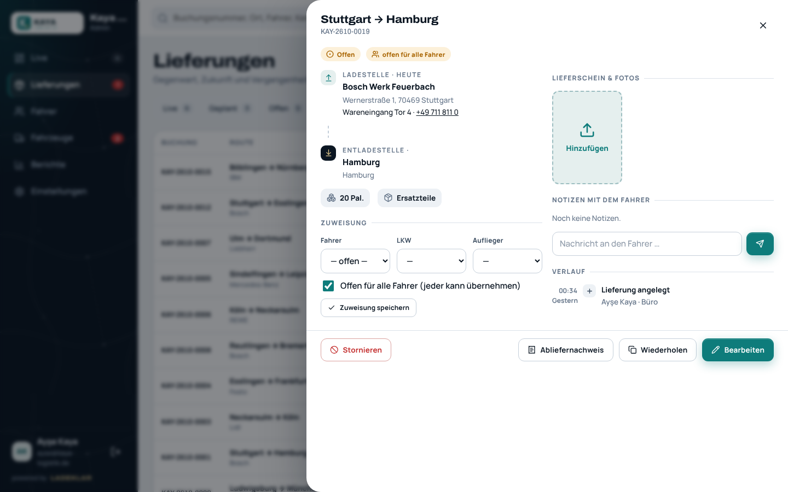

1. Wählen Sie **Fahrer**, **LKW** und **Auflieger**.
2. Solange die Lieferung offen ist und keinen Fahrer hat, können Sie **Offen für alle Fahrer (jeder kann übernehmen)** an- oder abhaken. Ohne Haken bleibt die Lieferung im Büro, bis Sie sie zuweisen.
3. Klicken Sie auf **Zuweisung speichern**.

Regeln beim Fahrerwechsel:

- Nach dem Beladen kann der Fahrer nicht mehr gewechselt werden.
- Wechseln Sie den Fahrer einer schon bestätigten Tour, wird sie wieder „Offen“; der neue Fahrer muss sie bestätigen. Der bisherige Fahrer bekommt die Mitteilung „Auftrag storniert“.

### Wiederholen – Stammrouten in Sekunden

1. Öffnen Sie eine frühere Lieferung (z. B. über **Erledigt** oder die Suche).
2. Klicken Sie auf **Wiederholen**.
3. Es öffnet sich „Lieferung wiederholen“ mit allen Daten der alten Lieferung. Das Ladedatum ist heute, das Entladedatum ist um denselben Abstand verschoben. **Referenz**, **Fahrer**, **LKW** und **Auflieger** sind leer.
4. Passen Sie an, was sich geändert hat, und klicken Sie auf **Lieferung anlegen**.

### Bearbeiten

Klicken Sie in der Lieferung auf **Bearbeiten**, ändern Sie die Felder und klicken Sie auf **Speichern**. Ändern Sie Orte, Ware, Hinweise, Fahrzeuge oder „Eilig“, bekommt der Fahrer die Mitteilung „Auftrag geändert“.

Grenzen:

- Die **Ladestelle** lässt sich nach dem Beladen nicht mehr ändern.
- **Abgeschlossene** Lieferungen (zugestellt oder storniert) lassen sich nur noch bei Auftraggeber, Referenz und interner Notiz ändern.

### Stornieren

1. Öffnen Sie die Lieferung und klicken Sie unten links auf **Stornieren**.
2. Tragen Sie einen **Grund (geht an den Fahrer)** ein, z. B. „Kunde hat verschoben“.
3. Klicken Sie auf **Stornieren**.

Der Fahrer bekommt sofort eine dringende Mitteilung. Die Lieferung steht danach mit Status „Storniert“ unter **Erledigt**. Eine Stornierung lässt sich nicht zurücknehmen – legen Sie die Tour bei Bedarf mit **Wiederholen** neu an. Bereits abgeschlossene Lieferungen können nicht storniert werden.

---

## 5. Den Fortschritt verstehen

### Die Status-Kette

Jede Lieferung durchläuft eine feste Reihenfolge. Welche Schritte es gibt, hängt vom Schalter **Ankunft an Lade- und Entladestelle erfassen** ab.

| Fahrer tippt | Status danach | In der Fortschrittsleiste | Nur mit Ankunft-Erfassung |
|---|---|---|---|
| (Lieferung angelegt) | **Offen** | – | |
| **Buchung bestätigen** bzw. **Auftrag übernehmen** | **Bestätigt** | Bestätigt | |
| **Angekommen – Ladestelle** | **An Ladestelle** | Ankunft | ja |
| **Aufgeladen** | **Beladen · unterwegs** | Beladen | |
| **Angekommen – Entladestelle** | **An Entladestelle** | Ankunft | ja |
| **Abgeladen** | **Entladen** | Entladen | |
| **Bestätigen & abschließen** | **Zugestellt** | Zugestellt | |
| (Büro storniert) | **Storniert** | – | |

- **Ohne** Ankunft-Erfassung hat die Fortschrittsleiste vier Schritte: Bestätigt · Beladen · Entladen · Zugestellt.
- **Mit** Ankunft-Erfassung sind es sechs: Bestätigt · Ankunft · Beladen · Ankunft · Entladen · Zugestellt.

Der Fahrer sieht immer nur den nächsten Schritt als großen Knopf. Er kann keinen Schritt überspringen. Darunter hat er immer **Navi**, **Anrufen**, **Notiz** und **Problem**, dazu **Alle Details**.

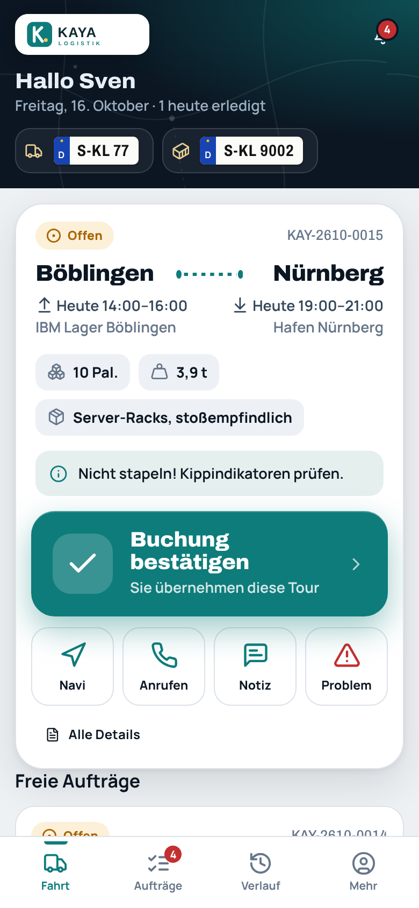

### Zeitstempel

Unter jedem erledigten Schritt der Fortschrittsleiste steht die Uhrzeit. Alle Zeiten sind deutsche Zeit (Europe/Berlin).

### Der Verlauf

In jeder geöffneten Lieferung steht rechts unten der **Verlauf** – ein Zeitstrahl mit allem, was passiert ist, neueste Meldung oben:

- Uhrzeit und Tag
- was passiert ist (z. B. „Lieferung angelegt“, „Fahrer zugewiesen“, „Buchung bestätigt“, „Aufgeladen“, „Dokument hochgeladen“, „Notiz“, „Problem gemeldet“, „Problem erledigt“, „Geändert“, „Fahrzeug gesetzt“, „Zurückgegeben“, „Storniert“, „Schritt zurückgenommen“)
- wer es getan hat; Aktionen aus dem Büro sind mit „Büro“ gekennzeichnet
- Details, z. B. der Palettentausch beim Abladen oder die Art des Dokuments
- einen Link **Standort**, wenn der Standort beim Tipp gespeichert wurde (nur mit Einwilligung des Fahrers, siehe [Abschnitt 12](#datenschutz-standort-und-auswertungen-je-fahrer))

### Rückgängig (2 Minuten)

Hat sich ein Fahrer vertippt, kann er seinen eigenen letzten Schritt 2 Minuten lang mit **Rückgängig** zurücknehmen. Die Leiste unten in seiner App zeigt den Schritt mit Uhrzeit und einem ablaufenden Ring.

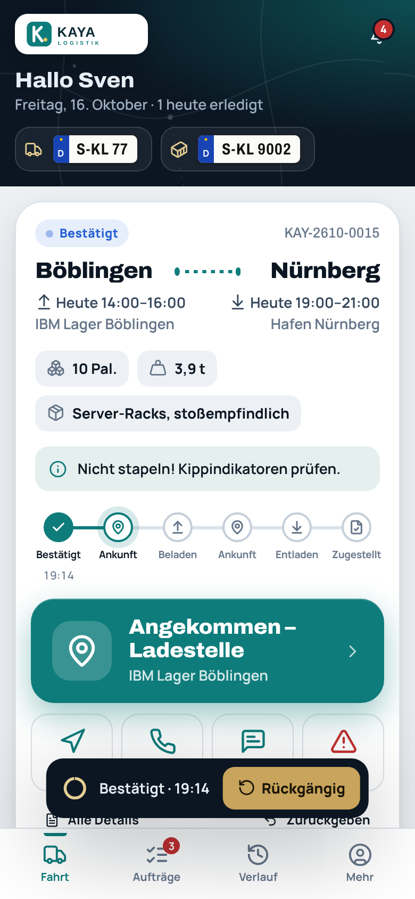 Sie bekommen dann die Mitteilung „Schritt zurückgenommen“. Im Verlauf bleibt der zurückgenommene Schritt sichtbar, ausgegraut, mit dem Eintrag „Schritt zurückgenommen – wieder „…““. Nimmt ein Fahrer „Auftrag übernehmen“ bei einem offenen Auftrag zurück, ist die Tour wieder für alle frei.

### Zurückgegeben

Solange noch nicht geladen ist (Status „Bestätigt“ oder „An Ladestelle“), kann der Fahrer eine Tour mit Grund zurückgeben, z. B. „krank, LKW defekt, Lenkzeit erreicht“. Sie bekommen eine dringende Mitteilung „Auftrag zurückgegeben“. Die Lieferung ist danach wieder **Offen**, ohne Fahrer und **nicht** für alle freigegeben – bitte weisen Sie sie neu zu (siehe [Zuweisen](#zuweisen-oder-offen-für-alle)). Nach dem Beladen kann der Fahrer nicht mehr zurückgeben; er ruft dann die Disposition an.

### Standzeit

Mit Ankunft-Erfassung berechnet Ladeklar die **Standzeit**: die Minuten von „Angekommen – Ladestelle“ bis „Aufgeladen“ plus von „Angekommen – Entladestelle“ bis „Abgeladen“. Sie steht in der Lieferung („Standzeit 30 Min.“), in der Tabelle unter **Erledigt**, im Abliefernachweis und in den Berichten – die Grundlage für Standgeld-Rechnungen. Auch der Fahrer sieht sie: In seiner App unter **Verlauf** stehen seine abgeschlossenen Touren der letzten 30 Tage mit Standzeit.

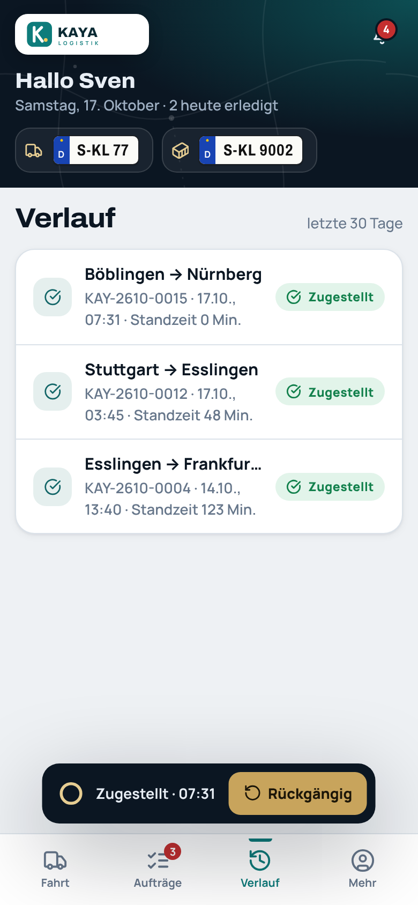

---

## 6. Lieferschein, Fotos, Unterschrift und Abliefernachweis

### So kommt der Lieferschein ins Büro

Nach „Abgeladen“ öffnet der Fahrer mit dem nächsten Knopf den Bildschirm **Abschluss**:

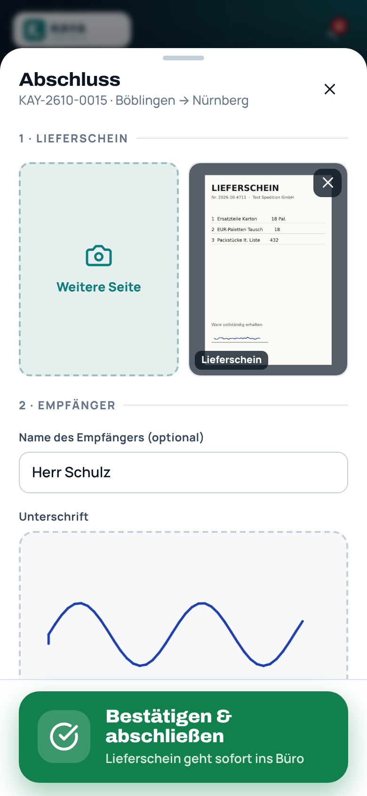

1. **1 · Lieferschein:** Der Fahrer fotografiert den Lieferschein. Mehrseitige Lieferscheine fotografiert er Seite für Seite (**Weitere Seite**). Er kann auch eine PDF-Datei wählen. Fotos werden vor dem Senden automatisch verkleinert, damit sie auch im Ausland mit wenig Datenvolumen schnell ankommen.
2. **2 · Empfänger:** Name des Empfängers und – wenn verlangt oder gewünscht – die **Unterschrift** auf dem Display.
3. **Bestätigen & abschließen:** Die Lieferung ist zugestellt; Sie bekommen die Mitteilung „Zugestellt · … Lieferschein liegt vor“.

Ist **Lieferschein-Foto ist Pflicht** eingeschaltet, kann der Fahrer erst abschließen, wenn mindestens ein Foto da ist. Ist **Unterschrift des Empfängers verlangen** eingeschaltet, geht es erst mit Unterschrift.

### Lieferschein und Fotos im Büro

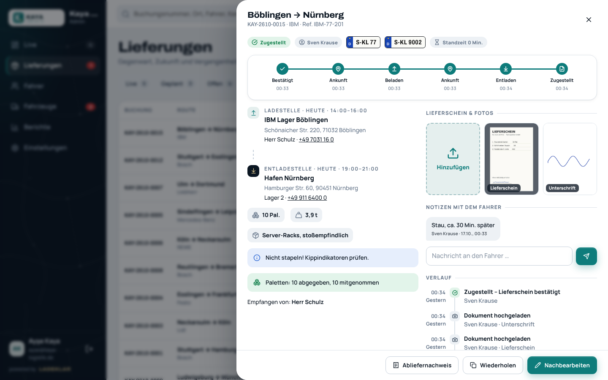

In der geöffneten Lieferung stehen rechts unter **Lieferschein & Fotos** alle Dokumente als kleine Bilder, beschriftet mit „Lieferschein“, „Schaden“ oder „Unterschrift“.

- Ein Klick vergrößert das Bild; **Original** öffnet es in voller Größe. PDF-Dateien öffnen sich in einem neuen Fenster.
- Mit **Hinzufügen** laden Sie selbst Fotos oder PDFs hoch – zum Beispiel, wenn der Fahrer den Papier-Lieferschein ins Büro bringt. Das geht auch noch nach der Zustellung.
- Solange die Lieferung nicht abgeschlossen ist, können Sie ein Dokument mit dem kleinen **×** entfernen.
- Erlaubt sind Fotos (JPG, PNG, WebP) bis 10 MB und PDF-Dateien bis 15 MB.

### Abliefernachweis (Drucken / PDF)

Der Abliefernachweis fasst eine Lieferung auf einem Blatt zusammen – für Ihren Kunden oder Ihre Buchhaltung, damit die Rechnung am selben Tag raus kann.

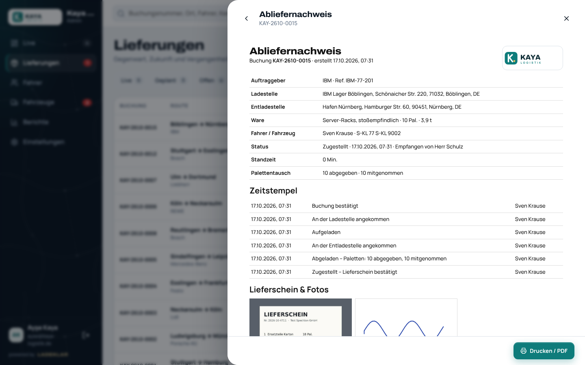

1. Öffnen Sie die Lieferung und klicken Sie auf **Abliefernachweis**.
2. Prüfen Sie den Inhalt: Ihr Logo, Buchungsnummer, Auftraggeber und Referenz, Lade- und Entladestelle, Ware, Fahrer und Fahrzeug, Status mit „Empfangen von …“, Standzeit und Palettentausch (falls erfasst), alle **Zeitstempel** mit Person sowie **Lieferschein & Fotos** mit Unterschrift.
3. Klicken Sie auf **Drucken / PDF**. Es öffnet sich der Druckdialog Ihres Browsers. Wählen Sie einen Drucker oder „Als PDF speichern“.
4. Mit dem Pfeil oben links kommen Sie zurück zur Lieferung.

> **Tipp:** Zurückgenommene Schritte erscheinen im Abliefernachweis nicht – dort stehen nur die gültigen Zeitstempel.

---

## 7. Störungen und Notizen

### Störungen

Der Fahrer meldet ein Problem mit dem Knopf **Problem** auf seiner Tour-Karte:

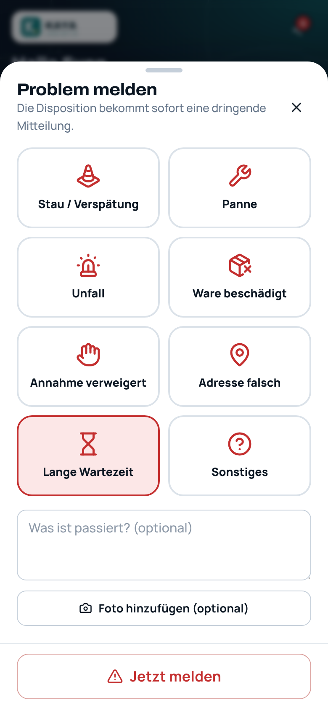

| Gründe, die der Fahrer wählen kann | |
|---|---|
| Stau / Verspätung | Panne |
| Unfall | Ware beschädigt |
| Annahme verweigert | Adresse falsch |
| Lange Wartezeit | Sonstiges |

Dazu kann er einen kurzen Text und ein Foto mitschicken. Das Foto liegt danach als „Schaden“ bei den Dokumenten.

So sehen Sie die Störung:

- sofort als **dringende Mitteilung** (rotes Symbol, mit Ton)
- auf der Live-Übersicht in der roten Kachel **Störungen** und als rot markierte Tour
- unter **Lieferungen → Störungen**
- in der Lieferung als rotes Band mit Grund, Text und „vor … Min.“

Wenn die Störung geklärt ist, klicken Sie im roten Band auf **Erledigt**. Der Fahrer bekommt die Mitteilung „Problem erledigt“. Im Verlauf bleiben Meldung und Erledigung stehen, und in den Berichten zählt die Lieferung weiter unter „Probleme“.

> **Wichtig:** Eine Lieferung hat immer höchstens eine offene Störung. Meldet der Fahrer ein zweites Problem, ersetzt es die Anzeige; die erste Meldung bleibt im Verlauf.

### Notizen mit dem Fahrer

Unter **Notizen mit dem Fahrer** schreiben Sie und der Fahrer sich kurze Nachrichten zu genau dieser Lieferung:

1. Text in das Feld **Nachricht an den Fahrer …** schreiben.
2. Auf den Senden-Pfeil klicken.

Der Fahrer bekommt eine Mitteilung „Notiz von …“. Umgekehrt bekommen Sie eine Mitteilung, wenn der Fahrer eine Notiz schickt. Fahrer haben dafür Schnellbausteine wie „Stau, ca. 30 Min. später“, „Warte an der Rampe“, „Kunde nicht erreichbar“, „Paletten getauscht“, „Ladung gesichert“ und „Pause (Lenkzeit)“.

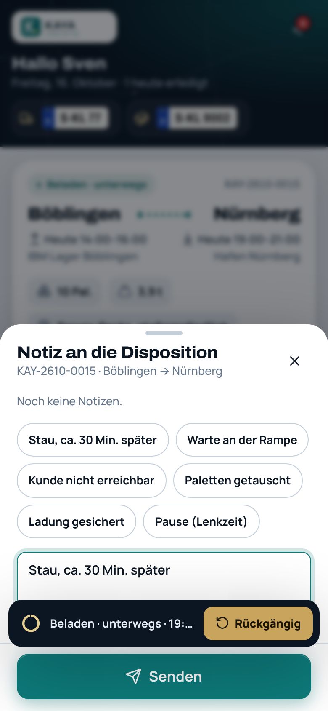

Daneben gibt es zwei Notizfelder im Formular der Lieferung:

- **Hinweise für den Fahrer** – stehen auf seiner Tour-Karte.
- **Interne Notiz (sieht der Fahrer nicht)** – nur für das Büro; in der Lieferung mit einem Schloss als „Intern“ markiert.

---

## 8. Für Fahrer setzen – wenn ein Fahrer anruft

Manchmal kann der Fahrer nicht tippen: Akku leer, Handy defekt, oder er ruft ohnehin gerade an. Dann setzen Sie den Schritt für ihn.

1. Öffnen Sie die Lieferung.
2. Unten steht der Knopf **Für Fahrer setzen: …** mit dem nächsten Schritt, z. B. „Für Fahrer setzen: Angekommen – Entladestelle“.
3. Klicken Sie darauf. Oben erscheint „Gesetzt: …“.

Gut zu wissen:

- Der Knopf erscheint erst, wenn die Lieferung bestätigt ist, und nur bis zur Zustellung. Eine offene Lieferung bestätigt immer der Fahrer selbst.
- Im Verlauf steht Ihr Name mit dem Zusatz „Büro“ – so ist klar, wer den Schritt gesetzt hat.
- Der Fahrer bekommt die Mitteilung „Auftrag geändert“ und sieht in seiner App den neuen Stand.
- Für **Zugestellt** brauchen Sie bei eingeschalteter Lieferschein-Pflicht zuerst einen Lieferschein: Laden Sie ihn mit **Hinzufügen** hoch (Foto oder PDF). Sonst erscheint „Bitte zuerst den Lieferschein hinzufügen (Foto/PDF).“
- Ist **Unterschrift des Empfängers verlangen** eingeschaltet, kann nur der Fahrer mit Unterschrift abschließen.
- Beim Setzen von „Abgeladen“ aus dem Büro wird kein Palettentausch abgefragt.

> **Wichtig:** Einen Schritt, den Sie für den Fahrer gesetzt haben, können Sie nicht zurücknehmen – „Rückgängig“ gibt es nur für den Fahrer und nur für seine eigenen Schritte. Prüfen Sie den Knopftext, bevor Sie klicken.

---

## 9. Fahrer verwalten

Unter **Fahrer** sehen Sie alle Fahrer als Karten. Oben steht, wie viele Fahrer-Plätze Ihres Tarifs belegt sind (z. B. „6 von 15 Fahrer-Plätzen belegt“).

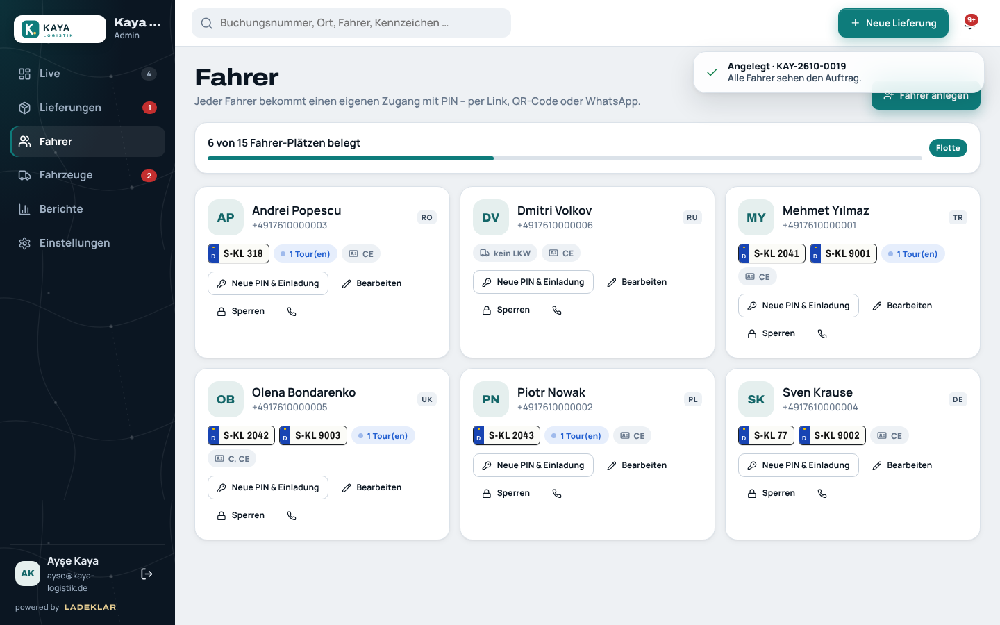

Jede Karte zeigt Name, Handynummer, die Sprache der App (Kürzel rechts oben), gewählte Kennzeichen oder „kein LKW“, laufende Touren, Führerscheinklasse und ggf. „gesperrt“. Darunter: **Neue PIN & Einladung**, **Bearbeiten**, **Sperren** bzw. **Entsperren** und ein Telefon-Knopf zum Anrufen.

### Fahrer anlegen

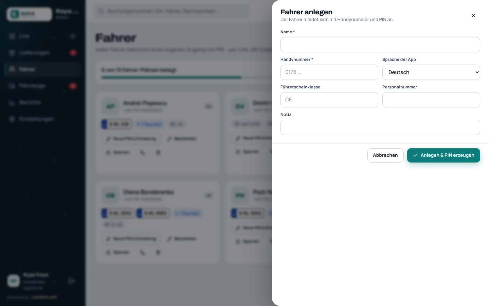

1. Klicken Sie auf **Fahrer anlegen**.
2. Füllen Sie aus:
   - **Name \*** und **Handynummer \*** (Pflicht; die Handynummer ist der Login)
   - **Sprache der App** (Deutsch, English, Polski, Română, Čeština, Türkçe, Русский, Українська)
   - **Führerscheinklasse**, **Personalnummer**, **Notiz** (freiwillig)
3. Klicken Sie auf **Anlegen & PIN erzeugen**.

Die Handynummer speichert Ladeklar international (aus „0176 …“ wird „+49176 …“). Jede Nummer darf es in Ihrem Unternehmen nur einmal geben.

### Einladung per QR-Code, WhatsApp oder SMS

Nach dem Anlegen öffnet sich das Fenster **Zugang für …**:

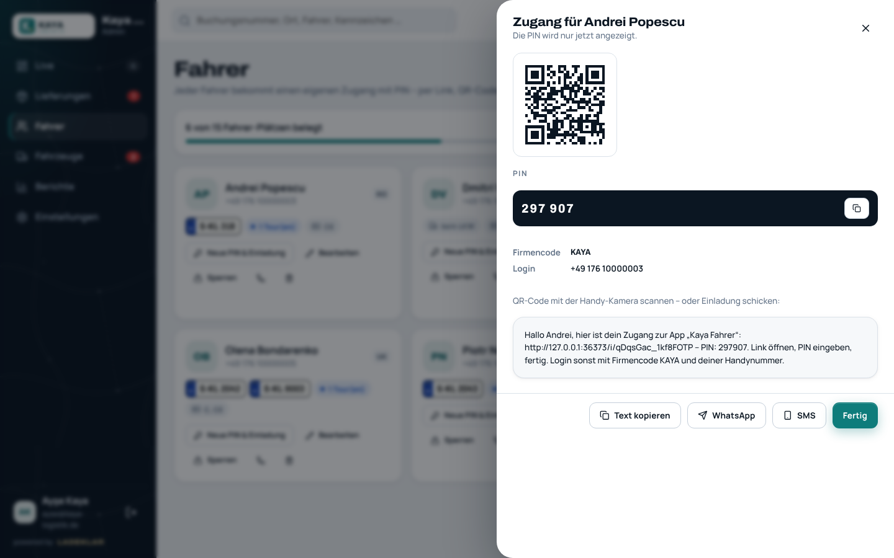

- **QR-Code:** Der Fahrer scannt ihn mit der Handy-Kamera und gibt nur noch die PIN ein.
- **PIN:** 6 Ziffern. Mit dem Kopier-Knopf daneben übernehmen Sie sie in die Zwischenablage.
- **Firmencode** und **Login** (die Handynummer) für die Anmeldung ohne Link.
- **Einladungstext** zum Weiterleiten, zum Beispiel: „Hallo Andrei, hier ist dein Zugang zur App „Kaya Fahrer“: [Link] – PIN: 715185. Link öffnen, PIN eingeben, fertig. Login sonst mit Firmencode KAYA und deiner Handynummer.“
- **WhatsApp** und **SMS** öffnen die jeweilige App mit dem fertigen Text an die Nummer des Fahrers; **Text kopieren** für jeden anderen Weg.

> **Wichtig:** Die PIN wird nur jetzt angezeigt. Schicken Sie die Einladung, bevor Sie auf **Fertig** klicken. Haben Sie es vergessen, erzeugen Sie mit **Neue PIN & Einladung** einfach eine neue.

So kann sich ein Fahrer anmelden:

| Weg | Was der Fahrer eingibt |
|---|---|
| Einladungslink oder QR-Code | nur die PIN |
| Link Ihrer Firma (unter **Firma & Marke** angezeigt, z. B. `…/t/KAYA`) | Handynummer und PIN |
| allgemeine Anmeldeseite, Reiter **Fahrer** | Firmencode, Handynummer und PIN |

Statt der Handynummer kann der Fahrer im Feld „Handynummer“ auch seine **Personalnummer** eingeben, wenn Sie eine hinterlegt haben. Fahrer bleiben 90 Tage angemeldet, solange sie die App nutzen.

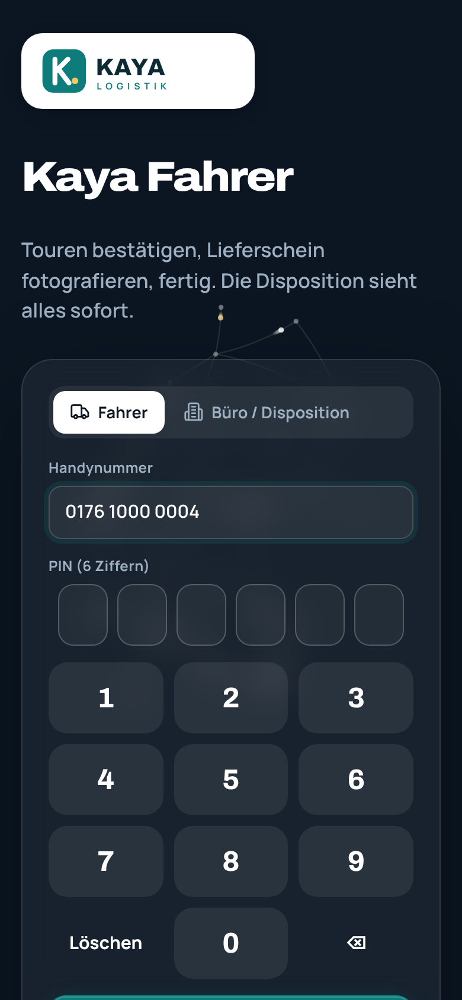

### Neue PIN & Einladung

Klicken Sie auf der Fahrerkarte auf **Neue PIN & Einladung**. Ladeklar erzeugt sofort eine neue PIN und zeigt wieder das Fenster mit QR-Code und Einladungstext.

- Die alte PIN gilt ab sofort nicht mehr.
- Der Fahrer wird auf allen Geräten abgemeldet und meldet sich mit der neuen PIN wieder an.
- Eine Sperre nach zu vielen falschen PINs wird damit ebenfalls aufgehoben.

### Fahrer sperren und entsperren

**Sperren** beendet sofort die Sitzung des Fahrers. Er kann sich nicht mehr anmelden, bekommt keine Mitteilungen mehr, und seine Fahrzeuge werden freigegeben. Der Platz in Ihrem Tarif wird frei. Seine Lieferungen und der Verlauf bleiben erhalten.

**Entsperren** macht den Zugang wieder nutzbar – sofern in Ihrem Tarif ein Fahrer-Platz frei ist.

> **Tipp:** Fahrer werden in Ladeklar nicht gelöscht, sondern gesperrt. So bleibt nachvollziehbar, wer welche Tour gefahren ist.

### Sprache des Fahrers

Die Sprache stellen Sie beim Anlegen oder unter **Bearbeiten** im Feld **Sprache der App** ein. Der Fahrer kann sie jederzeit selbst ändern (**Mehr → Sprache**). Mitteilungen an den Fahrer kommen in seiner Sprache.

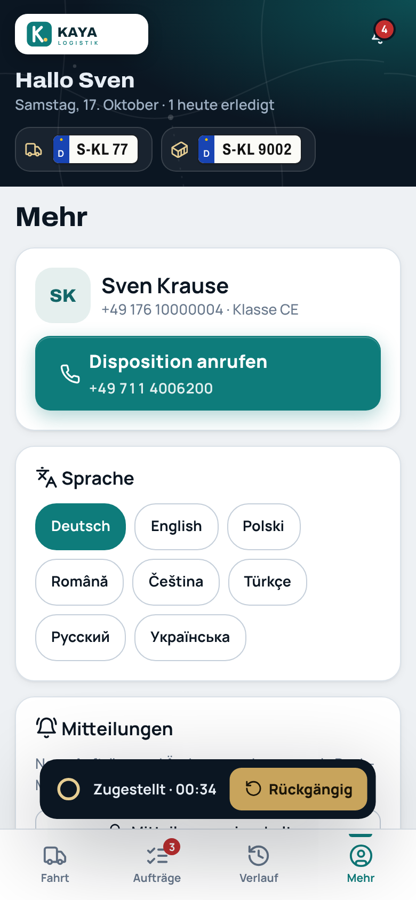

### Bearbeiten

Unter **Bearbeiten** ändern Sie Name, Handynummer, Sprache der App, Führerscheinklasse, Personalnummer und Notiz. Ändern Sie die Handynummer, meldet sich der Fahrer künftig mit der neuen Nummer an.

---

## 10. Der Fahrzeug-Pool

Unter **Fahrzeuge** verwalten Sie den Pool, aus dem Ihre Fahrer LKW und Auflieger wählen.

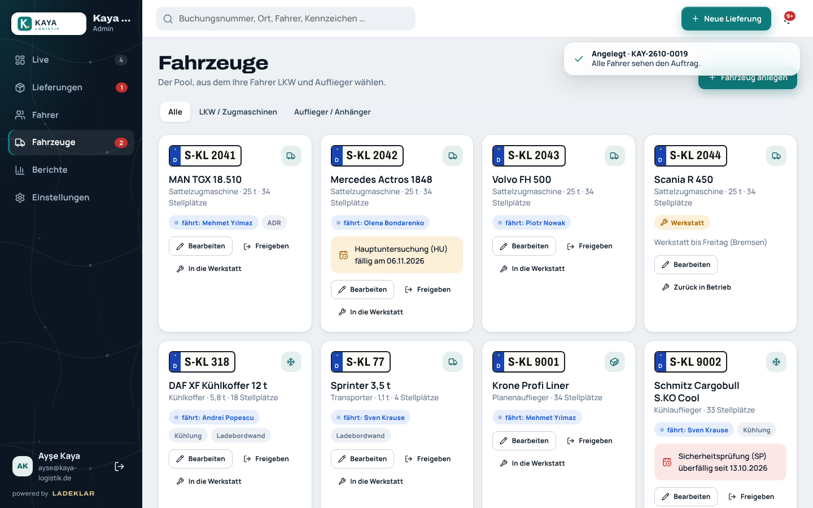

Oben filtern Sie nach **Alle**, **LKW / Zugmaschinen** oder **Auflieger / Anhänger**. Jede Karte zeigt Kennzeichen, Bezeichnung, Art, Nutzlast und Palettenstellplätze sowie den Zustand:

| Anzeige | Bedeutung |
|---|---|
| **frei** | kann gewählt werden |
| **fährt: Name** | ein Fahrer hat das Fahrzeug gewählt – es ist belegt |
| **Werkstatt** | nicht wählbar |
| HU/SP-Hinweis gelb | Termin in den nächsten 30 Tagen („fällig am …“) |
| HU/SP-Hinweis rot | Termin vorbei („überfällig seit …“) |

### Fahrzeug anlegen

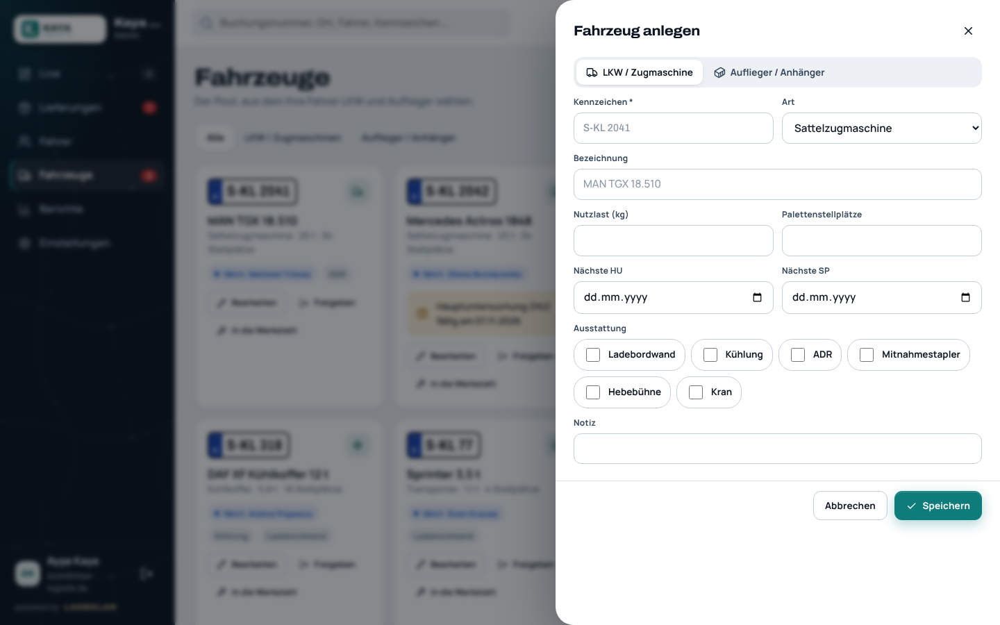

1. Klicken Sie auf **Fahrzeug anlegen**.
2. Wählen Sie **LKW / Zugmaschine** oder **Auflieger / Anhänger** (lässt sich später nicht mehr ändern).
3. Füllen Sie aus:
   - **Kennzeichen \*** (jedes Kennzeichen nur einmal)
   - **Art** – LKW: Sattelzugmaschine, Solo-LKW, Gliederzug, Kühlkoffer, Kipper, Tankwagen, Transporter; Auflieger: Planenauflieger, Kühlauflieger, Kipper, Container-Chassis, Tieflader, Kofferauflieger
   - **Bezeichnung** (z. B. „MAN TGX 18.510“), **Nutzlast (kg)**, **Palettenstellplätze**
   - **Nächste HU** und **Nächste SP**
   - **Ausstattung**: Ladebordwand, Kühlung, ADR, Mitnahmestapler, Hebebühne, Kran
   - **Notiz** (z. B. „Werkstatt bis Freitag (Bremsen)“)
4. Klicken Sie auf **Speichern**.

Mit **Bearbeiten** ändern Sie die Angaben später; dort finden Sie auch **Entfernen**, um ein Fahrzeug aus dem Pool zu nehmen. Frühere Lieferungen behalten das Kennzeichen.

### Wie „belegt“ funktioniert

Ist **Fahrer wählen ihr Fahrzeug selbst** eingeschaltet, tippt der Fahrer in seiner App auf **LKW wählen** und dann auf sein Kennzeichen:

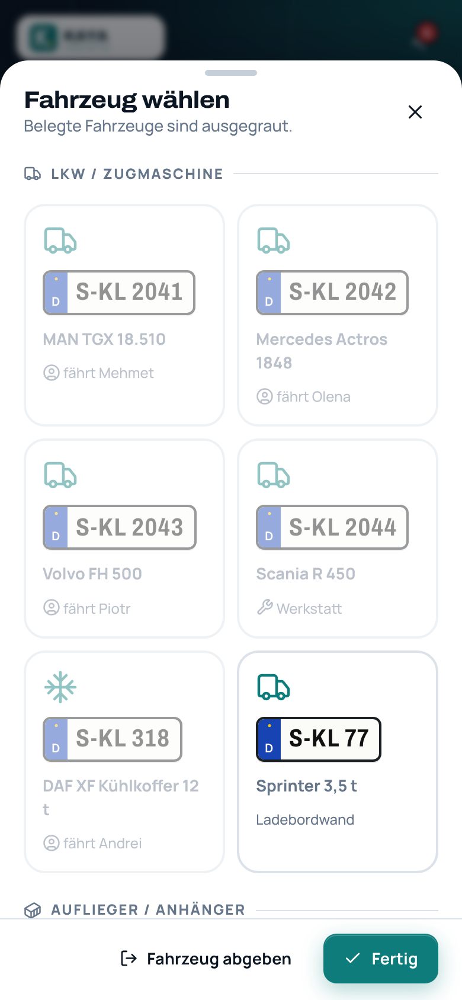

- Ein gewähltes Fahrzeug gehört dem Fahrer, bis er es mit **Fahrzeug abgeben** zurückgibt. So können nie zwei Fahrer denselben LKW wählen.
- Andere Fahrer sehen es ausgegraut mit „fährt …“.
- Hat eine laufende Lieferung noch kein Fahrzeug, übernimmt sie automatisch LKW und Auflieger, die der Fahrer gewählt hat.

Im Büro haben Sie drei Knöpfe:

- **Freigeben** – löst das Fahrzeug vom Fahrer, z. B. wenn er vergessen hat, es abzugeben.
- **In die Werkstatt** – das Fahrzeug ist nicht mehr wählbar; ein Fahrer, der es gewählt hatte, wird gelöst.
- **Zurück in Betrieb** – das Fahrzeug ist wieder frei.

Auch beim Sperren eines Fahrers werden seine Fahrzeuge freigegeben.

Ist **Fahrer wählen ihr Fahrzeug selbst** ausgeschaltet, teilen Sie LKW und Auflieger direkt in jeder Lieferung zu (Felder **LKW** und **Auflieger**).

---

## 11. Berichte

Unter **Berichte** sehen Sie Leistung, Pünktlichkeit, Standzeiten und Palettenkonto für einen Monat. Oben rechts wählen Sie den Monat (die letzten sechs Monate).

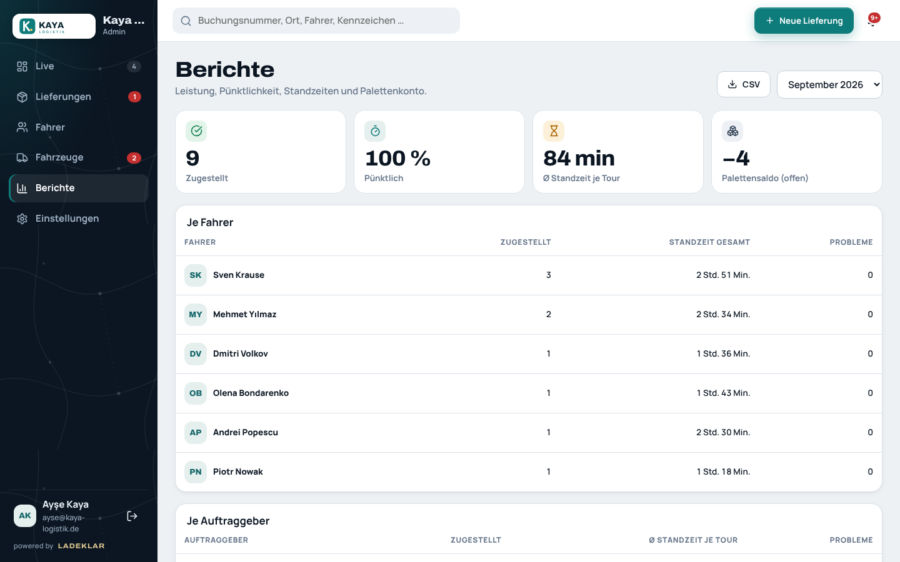

| Kennzahl | So wird gerechnet |
|---|---|
| **Zugestellt** | Lieferungen, die in diesem Monat zugestellt wurden |
| **Pünktlich** | Anteil der zugestellten Lieferungen, bei denen „Bestätigen & abschließen“ spätestens am Entladedatum bis zur Uhrzeit „bis“ getippt wurde (ohne Uhrzeit: bis 23:59). Lieferungen ohne Entladedatum zählen hier nicht mit. |
| **Ø Standzeit je Tour** | Durchschnitt der Standzeiten aller Touren, für die eine Standzeit erfasst wurde (braucht die Ankunft-Erfassung) |
| **Palettensaldo (offen)** | abgegebene minus mitgenommene EUR-Paletten aus dem Palettentausch. Ein Minuszeichen bedeutet: Ihre Fahrer haben so viele Paletten mehr abgegeben als leer zurückbekommen. |

Die Tabelle **Je Fahrer** zeigt pro Fahrer: **Zugestellt**, **Standzeit gesamt** und **Probleme** (Lieferungen mit gemeldeter Störung). Ist **Auswertungen je Fahrer anzeigen** ausgeschaltet, steht dort „Auswertungen je Fahrer sind ausgeschaltet (Einstellungen → Abläufe).“

Für eigene Auswertungen laden Sie die Lieferungen als CSV herunter (siehe [Abschnitt 14](#14-datenexport-und-anbieterwechsel)).

---

## 12. Einstellungen

Unter **Einstellungen** steht oben Ihr Firmenname und Ihr **Firmencode** – den brauchen Fahrer, die sich ohne Link anmelden. Admins sehen die Reiter **Firma & Marke · Abläufe · Team · Lizenz · Daten & Datenschutz · API · Mein Konto** und zusätzlich **Berichte** (führt zur Seite Berichte). Disponenten sehen nur **Mein Konto** und **Berichte**.

### Firma & Marke

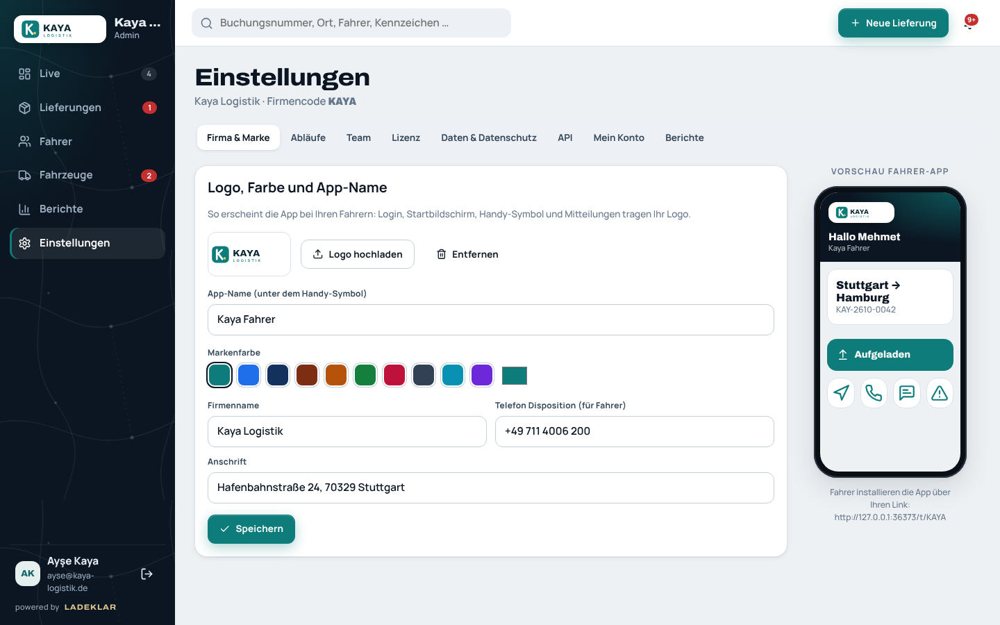

| Feld | Wirkung |
|---|---|
| **Logo hochladen** / **Entfernen** | Logo auf Anmeldeseite, Startbildschirm der Fahrer, Handy-Symbol und Mitteilungen. Wird sofort gespeichert. |
| **App-Name (unter dem Handy-Symbol)** | Name der App auf dem Handy und auf der Anmeldeseite (max. 40 Zeichen) |
| **Markenfarbe** | Farbe der Knöpfe und Kopfzeilen; zehn Vorschläge oder eigene Farbe im Farbfeld |
| **Firmenname** | erscheint u. a. auf der Anmeldeseite, die Fahrer über ihren Einladungslink öffnen („Ihre Firma … hat Sie eingeladen“) |
| **Telefon Disposition (für Fahrer)** | diese Nummer ruft der Fahrer mit „Disposition anrufen“ an |
| **Anschrift** | Ihre Firmenanschrift |

Klicken Sie auf **Speichern**. Ihre Fahrer sehen die neue Marke sofort. Unter der Vorschau steht der Link, über den Ihre Fahrer die App öffnen und auf dem Handy installieren (z. B. `…/t/KAYA`).

### Abläufe

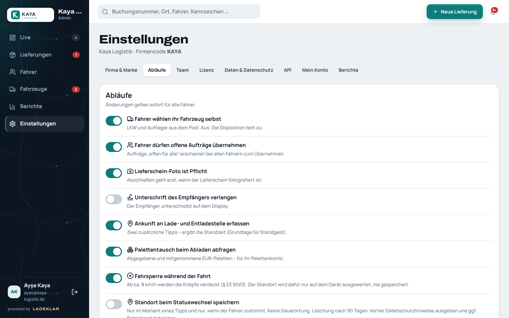

Jeder Schalter wird sofort gespeichert („Gespeichert – gilt sofort für alle Fahrer“).

| Schalter | Was er bewirkt | Voreinstellung |
|---|---|---|
| **Fahrer wählen ihr Fahrzeug selbst** | Fahrer wählen LKW und Auflieger aus dem Pool. Aus: Die Disposition teilt zu. | an |
| **Fahrer dürfen offene Aufträge übernehmen** | Aufträge „offen für alle“ erscheinen bei allen Fahrern zum Übernehmen. | an |
| **Lieferschein-Foto ist Pflicht** | Abschließen geht erst, wenn der Lieferschein fotografiert ist. | an |
| **Unterschrift des Empfängers verlangen** | Der Empfänger unterschreibt auf dem Display. | aus |
| **Ankunft an Lade- und Entladestelle erfassen** | Zwei zusätzliche Tipps – ergibt die Standzeit (Grundlage für Standgeld). | aus |
| **Palettentausch beim Abladen abfragen** | Beim Abladen trägt der Fahrer abgegebene und mitgenommene EUR-Paletten ein – für Ihr Palettenkonto. | aus |
| **Fahrsperre während der Fahrt** | Ab ca. 8 km/h werden die Knöpfe verdeckt (§ 23 StVO). Der Standort wird dafür nur auf dem Gerät ausgewertet, nie gespeichert. | an |
| **Standort beim Statuswechsel speichern** | Nur im Moment eines Tipps und nur, wenn der Fahrer zustimmt. Keine Dauerortung, Löschung nach 90 Tagen. | aus |
| **Auswertungen je Fahrer anzeigen** | Lieferungen, Standzeiten und Probleme je Fahrer in den Berichten. | an |

Darunter stellen Sie zwei Werte ein und klicken auf **Speichern**:

- **Präfix der Buchungsnummer** – bis zu 6 Buchstaben oder Ziffern, z. B. „KAY“ ergibt `KAY-2610-0042`.
- **Lieferscheine aufbewahren (Jahre)** – 1 bis 10 Jahre (Voreinstellung 3). Danach werden abgeschlossene Lieferungen samt Fotos automatisch gelöscht. Achten Sie auf Ihre gesetzlichen Aufbewahrungsfristen.

So sehen Ihre Fahrer den Palettentausch beim Abladen und die Fahrsperre:

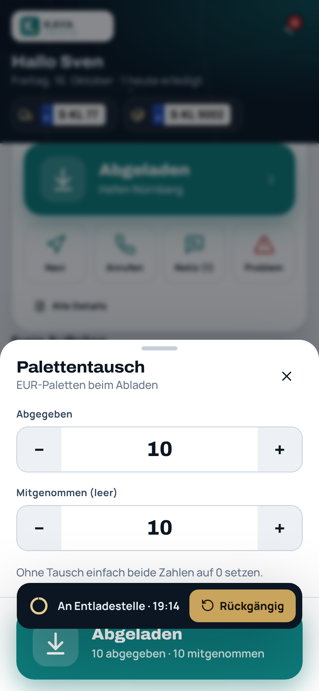

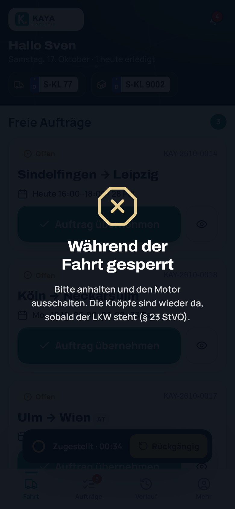

> **Tipp zur Fahrsperre:** Die Fahrsperre braucht den Standortzugriff auf dem Handy des Fahrers, damit die App die Geschwindigkeit erkennt. Hat der Fahrer den Zugriff nicht erlaubt, bleiben die Knöpfe auch während der Fahrt sichtbar. Weisen Sie Ihre Fahrer trotzdem darauf hin: Bedienung nur im Stand mit Motor aus.

#### Datenschutz: Standort und Auswertungen je Fahrer

> **Wichtig:** Ladeklar ortet Ihre Fahrer nicht dauerhaft. Mit **Standort beim Statuswechsel speichern** wird der Standort nur im Moment eines Tipps (z. B. „Aufgeladen“ oder „Problem melden“) gespeichert – und nur, wenn der Fahrer in seiner App zugestimmt hat („Standort beim Status-Tipp teilen?“). Er kann die Zustimmung jederzeit unter **Mehr** widerrufen. Gespeicherte Positionen werden nach 90 Tagen gelöscht. Im Verlauf erscheint dann ein Link **Standort**. Zustimmung und Widerruf stehen im Protokoll.

Bevor Sie den Standort oder die **Auswertungen je Fahrer** einschalten:

1. Geben Sie Ihren Fahrern die Datenschutzhinweise. Eine Vorlage liegt in `docs/recht/DATENSCHUTZHINWEISE_FAHRER.md`.
2. Haben Sie einen Betriebsrat, beteiligen Sie ihn. Technische Einrichtungen, die Verhalten oder Leistung überwachen können, sind mitbestimmungspflichtig (§ 87 Abs. 1 Nr. 6 BetrVG). Eine Muster-Betriebsvereinbarung liegt in `docs/recht/BETRIEBSVEREINBARUNG_MUSTER.md`.
3. Ohne Betriebsvereinbarung lassen Sie **Auswertungen je Fahrer anzeigen** im Zweifel aus. Die Kennzahlen für das ganze Unternehmen bleiben trotzdem sichtbar.

Die Muster ersetzen keine Rechtsberatung.

### Team

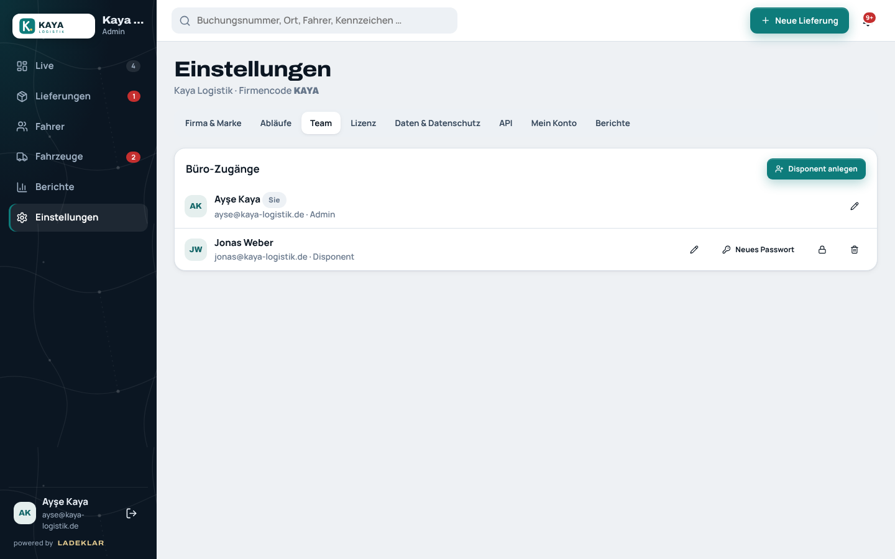

Unter **Büro-Zugänge** stehen alle Admins und Disponenten.

1. Klicken Sie auf **Disponent anlegen**.
2. Tragen Sie **Name \*** und **E-Mail \*** ein und wählen Sie **Rolle** (Disponent oder Admin) und **Sprache** (Deutsch, English oder Türkçe).
3. Klicken Sie auf **Anlegen**. Ladeklar zeigt das **Startpasswort** – nur dieses eine Mal. Geben Sie es der Person sicher weiter; sie ändert es beim ersten Anmelden unter **Mein Konto**.

Bei jedem anderen Zugang finden Sie:

- **Neues Passwort** – erzeugt ein neues Startpasswort und meldet die Person ab.
- das **Schloss** – sperrt den Zugang (bzw. entsperrt ihn wieder).

Ihren eigenen Zugang können Sie nicht sperren. Wie viele Büro-Zugänge Sie anlegen können, hängt vom Tarif ab (siehe [Abschnitt 15](#15-lizenz-und-tarif)).

### Lizenz

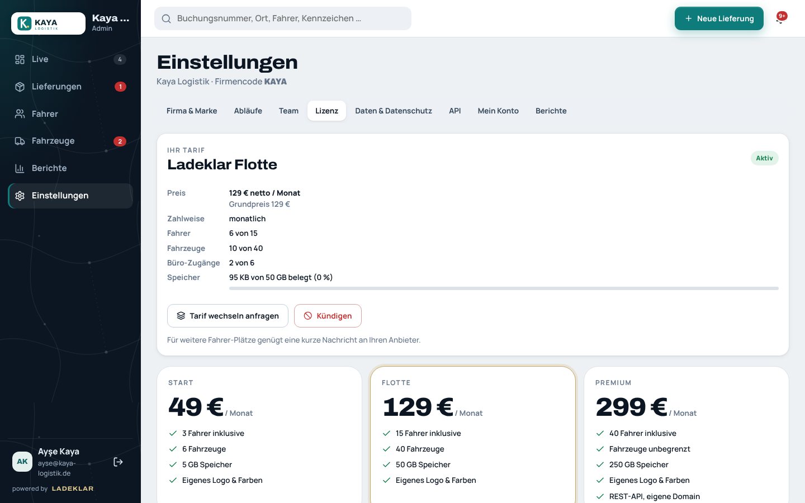

Hier sehen Sie Ihren Tarif, den Status (Testphase, Aktiv, Gesperrt, Abgelaufen oder Gekündigt), Preis, Fahrer-Plätze, Fahrzeuge und – falls zutreffend – **Test bis** oder **Laufzeit bis**. Darunter stehen alle Tarife zum Vergleich. Für einen Tarifwechsel oder weitere Fahrer-Plätze genügt eine kurze Nachricht an Ihren Anbieter. Mehr in [Abschnitt 15](#15-lizenz-und-tarif).

### Daten & Datenschutz

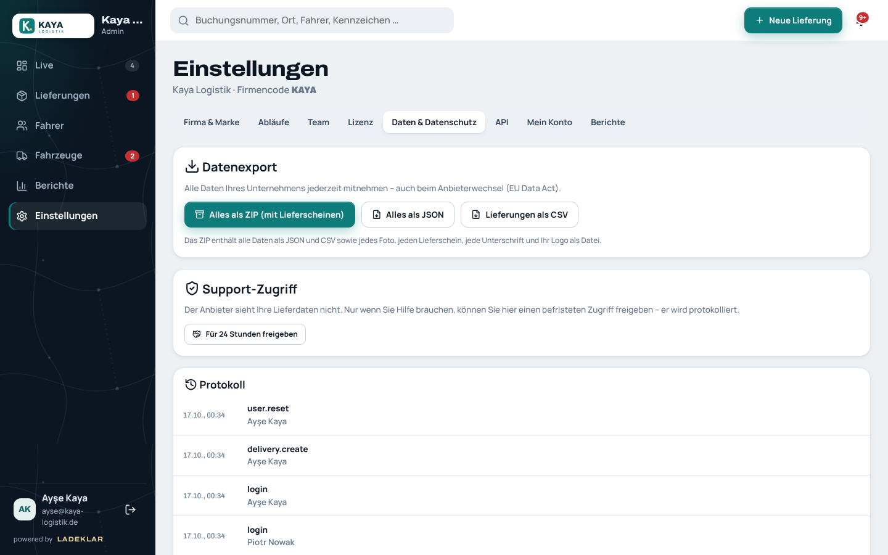

- **Datenexport:** **Alles als JSON** und **Lieferungen als CSV** – siehe [Abschnitt 14](#14-datenexport-und-anbieterwechsel).
- **Support-Zugriff:** Der Anbieter sieht Ihre Lieferdaten nicht. Brauchen Sie Hilfe, klicken Sie auf **Für 24 Stunden freigeben**. Danach steht dort „freigegeben bis …“, und mit **Jetzt beenden** nehmen Sie die Freigabe vorzeitig zurück. Freigabe und Ende werden protokolliert.
- **Protokoll:** die letzten Änderungen mit Zeit und Person. Die Einträge sind technische Kurznamen:

| Eintrag | Bedeutung |
|---|---|
| `delivery.create` / `delivery.update` / `delivery.cancel` | Lieferung angelegt / geändert / storniert |
| `user.create` / `user.update` | Zugang (Fahrer oder Büro) angelegt / geändert |
| `user.reset` | neue PIN bzw. neues Passwort erzeugt |
| `user.activate` / `user.deactivate` | Zugang entsperrt / gesperrt |
| `vehicle.create` / `vehicle.update` / `vehicle.delete` / `vehicle.release` | Fahrzeug angelegt / geändert / entfernt / freigegeben |
| `company.update` | Firma, Marke oder Abläufe geändert |
| `password.change` | eigenes Passwort geändert |
| `geo.consent` / `geo.withdraw` | Fahrer hat dem Standort beim Tipp zugestimmt / widersprochen |
| `support.grant` / `support.revoke` | Support-Zugriff freigegeben / beendet |
| `apikey.rotate` | API-Schlüssel erzeugt |
| `data.export` | Datenexport (JSON) heruntergeladen |

### API

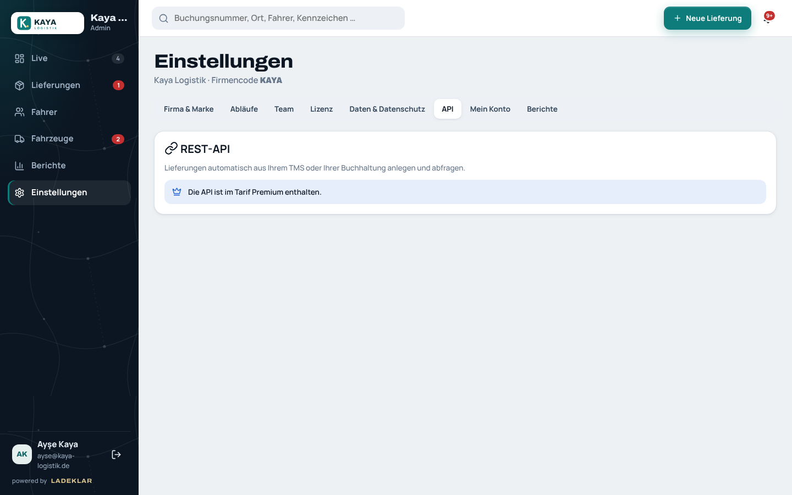

Mit der REST-API legen Sie Lieferungen automatisch aus Ihrem TMS oder Ihrer Buchhaltung an und fragen sie ab. Sie ist im Tarif **Premium** enthalten; in anderen Tarifen steht hier „Die API ist im Tarif Premium enthalten.“

Im Tarif Premium:

1. Klicken Sie auf **Schlüssel erzeugen** (später **Neuen Schlüssel erzeugen**).
2. Kopieren Sie den Schlüssel (beginnt mit `lk_`). **Der Schlüssel wird nur jetzt angezeigt.** Ein neuer Schlüssel macht den alten ungültig.
3. Geben Sie den Schlüssel Ihrem IT-Dienstleister. Der Reiter zeigt Beispielaufrufe.

| Aufruf | Wirkung |
|---|---|
| `GET /api/v1/deliveries` | Lieferungen abfragen (optional `?tab=…&q=…`) |
| `GET /api/v1/deliveries/{id}` | eine Lieferung abfragen |
| `POST /api/v1/deliveries` | Lieferung anlegen |
| `PATCH /api/v1/deliveries/{id}` | Lieferung ändern |

Der Schlüssel wird als `Authorization: Bearer lk_…` mitgeschickt. Lieferungen aus der API verhalten sich wie im Büro angelegte – inklusive Mitteilungen an die Fahrer.

### Mein Konto

Hier sehen Sie Name, E-Mail und Rolle, wählen die **Sprache** der Büro-Oberfläche (Deutsch, English, Türkçe), ändern Ihr Passwort (**Aktuelles Passwort**, **Neues Passwort (mind. 10 Zeichen)**, **Passwort ändern**) und melden sich mit **Abmelden** ab.

---

## 13. Mitteilungen und Push

### Die Glocke

Oben rechts zeigt die **Glocke** die Zahl ungelesener Mitteilungen. Ein Klick öffnet die Liste **Mitteilungen**; ein Klick auf eine Mitteilung öffnet die Lieferung. **Alle gelesen** setzt den Zähler zurück.

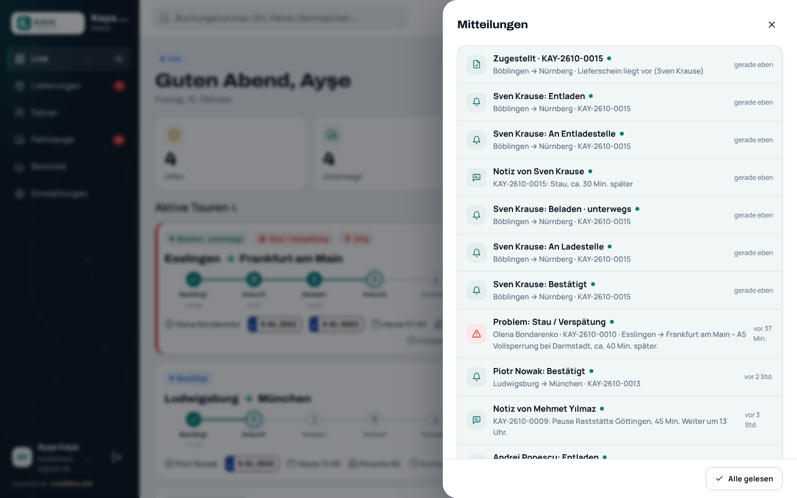

Ist die App geöffnet, erscheint jede neue Mitteilung zusätzlich kurz oben rechts, mit Ton. Dringende Mitteilungen (Problem, Zurückgegeben) sind rot und bleiben länger stehen.

### Wer bekommt welche Mitteilung?

| Ereignis | Büro (alle aktiven Admins und Disponenten) | Fahrer |
|---|---|---|
| Lieferung zugewiesen | – | „Neuer Auftrag …“ (dringend, wenn „Eilig“) |
| Lieferung offen für alle | – | „Offener Auftrag“ an alle aktiven Fahrer (nur wenn Fahrer offene Aufträge übernehmen dürfen) |
| Lieferung geändert | – | „Auftrag geändert“ |
| Lieferung storniert | – | „Auftrag storniert“ (dringend) |
| Fahrer gewechselt | – | bisheriger Fahrer: „Auftrag storniert“; neuer Fahrer: „Neuer Auftrag …“ |
| Fahrer bestätigt oder tippt einen Schritt | „Name: Status“ | – |
| Fahrer schließt ab | „Zugestellt · … Lieferschein liegt vor“ | – |
| Fahrer meldet Problem | „Problem: …“ (dringend) | – |
| Büro markiert Problem als erledigt | – | „Problem erledigt“ |
| Notiz | „Notiz von Fahrer“ | „Notiz von Büro-Mitarbeiter“ |
| Fahrer gibt Tour zurück | „Auftrag zurückgegeben“ (dringend) | – |
| Fahrer nimmt Schritt zurück | „Schritt zurückgenommen“ | – |
| Büro setzt Schritt für den Fahrer | – | „Auftrag geändert“ |

Mitteilungen an Fahrer kommen in der Sprache des Fahrers. Jeder Nutzer behält die letzten 100 Mitteilungen; ältere als 90 Tage werden gelöscht.

### Push-Mitteilungen einschalten

Push-Mitteilungen kommen auch, wenn der Browser bzw. die App geschlossen ist.

- **Im Büro:** Auf der Live-Übersicht erscheint „Push-Mitteilungen einschalten – dann sehen Sie jeden Status sofort, auch bei geschlossenem Browser.“ Klicken Sie auf **Einschalten** und erlauben Sie die Mitteilungen im Browser.
- **Beim Fahrer:** In der Fahrer-App unter **Mehr → Mitteilungen einschalten**.

> **Tipp:** Erscheint „Mitteilungen wurden im Browser blockiert“, wurden sie früher einmal abgelehnt. Erlauben Sie sie in den Website-Einstellungen des Browsers wieder. Auf dem iPhone kommen Push-Mitteilungen nur, wenn die App über „Zum Home-Bildschirm“ installiert wurde.

---

## 14. Datenexport und Anbieterwechsel

Ihre Daten gehören Ihnen. Sie können sie jederzeit mitnehmen – auch wenn die Lizenz gesperrt ist.

### Lieferungen als CSV

**Wo:** **Lieferungen → CSV** (Admin und Disponent) oder **Einstellungen → Daten & Datenschutz → Lieferungen als CSV**.

Die Datei öffnet sich direkt in Excel (Trennzeichen Semikolon). Sie enthält bis zu 1.000 Lieferungen mit diesen Spalten:

Buchungsnummer · Status · Auftraggeber · Referenz · Route · Ladeort · Ladedatum · Entladeort · Entladedatum · Fahrer · Kennzeichen · Auflieger · Ware · Paletten · Gewicht kg · Standzeit min · Empfänger · Lieferscheine (Anzahl) · Zugestellt am

### Alles als JSON

**Wo:** **Einstellungen → Daten & Datenschutz → Alles als JSON** (nur Admin).

Die Datei enthält den vollständigen Datenbestand Ihres Unternehmens in maschinenlesbarer Form: Firmendaten und Einstellungen, alle Zugänge (ohne Passwörter und PINs), Fahrzeuge, Lieferungen mit Verlauf und Notizen, die Liste aller Dateien und das Protokoll. Jeder Export wird im Protokoll vermerkt.

> **Wichtig:** Die Fotos und PDF-Dateien selbst stecken nicht in der JSON-Datei, dort steht nur ihre Liste. Für einzelne Lieferungen speichern Sie den Abliefernachweis als PDF; für ein vollständiges Datei-Archiv wenden Sie sich an Ihren Anbieter.

### Anbieterwechsel – so gehen Sie vor

1. Laden Sie **Alles als JSON** und **Lieferungen als CSV** herunter.
2. Speichern Sie für wichtige Lieferungen den **Abliefernachweis** als PDF oder fordern Sie bei Ihrem Anbieter das Datei-Archiv an.
3. Erst danach kündigen. Nach Ende eines gekündigten Vertrags ist keine Anmeldung im Büro mehr möglich.

### Löschfristen

| Was | Wird gelöscht nach |
|---|---|
| Abgeschlossene Lieferungen mit Lieferscheinen, Fotos und Unterschrift | der eingestellten Aufbewahrung (1–10 Jahre, **Einstellungen → Abläufe**) |
| Gespeicherte Standorte beim Statuswechsel | 90 Tagen |
| Mitteilungen | 90 Tagen |
| Protokoll | 3 Jahren |

---

## 15. Lizenz und Tarif

### Tarife

Alle Preise netto zzgl. 19 % USt., je Monat.

| | **Start** | **Flotte** | **Premium** |
|---|---|---|---|
| Preis | 49 € | 129 € | 299 € |
| Fahrer inklusive | 3 | 15 | 40 |
| jeder weitere Fahrer | – (Tarifwechsel) | 7 € | 6 € |
| Fahrzeuge (LKW und Auflieger) | 6 | 40 | unbegrenzt |
| Disponenten-Zugänge (zusätzlich zum Admin) | 1 | 5 | unbegrenzt |
| Lieferschein-Speicher | 5 GB | 50 GB | 250 GB |
| Eigenes Logo, Farben, App-Name | ja | ja | ja |
| Eigene Subdomain / eigene Domain | – | Subdomain | eigene Domain |
| REST-API, SLA 99,5 % | – | – | ja |

Zusatz zu Premium: **White-Label-App im App Store und bei Google Play** mit Ihrem Namen und Symbol – 1.990 € einmalig plus 99 € je Monat.

Neue Kunden testen in der Regel 30 Tage kostenlos. Bei jährlicher Zahlung sind zwei Monate geschenkt.

### Grenzen des Tarifs

Ladeklar prüft die Grenzen beim Anlegen:

- **Fahrer:** Es zählen nur aktive (nicht gesperrte) Fahrer. Ist das Limit erreicht, erscheint z. B. „Ihr Tarif „Flotte“ umfasst 15 Fahrer. Für weitere Fahrer bitte Tarif erweitern.“
- **Fahrzeuge:** Es zählen alle Fahrzeuge im Pool (entfernte nicht).
- **Büro-Zugänge:** Admin plus die Zahl der Disponenten aus der Tabelle.

Für mehr Plätze genügt eine Nachricht an Ihren Anbieter.

### Was der Lizenz-Status bedeutet

| Status | Büro | Fahrer |
|---|---|---|
| **Testphase** | alle Funktionen; ab 10 Tagen vor Ende erscheint ein Hinweis „Testphase: noch … Tage“ | alle Funktionen |
| **Aktiv** | alle Funktionen | alle Funktionen |
| **Abgelaufen** (Test oder Laufzeit vorbei) | anmelden, ansehen und exportieren – aber nichts ändern | keine Anmeldung möglich |
| **Gesperrt** (z. B. Zahlung offen) | anmelden, ansehen und exportieren – aber nichts ändern | keine Anmeldung möglich |
| **Gekündigt** | keine Anmeldung mehr möglich | keine Anmeldung möglich |

Bei „Abgelaufen“ und „Gesperrt“ steht oben der Hinweis „Ihr Zugang ist gesperrt. Daten können angesehen und exportiert werden. Bitte melden Sie sich beim Anbieter.“ Wer dann etwas ändern will, sieht „Die Lizenz ist nicht aktiv. Daten können angesehen und exportiert, aber nicht geändert werden.“ Fahrer, die sich anmelden wollen, sehen „Der Zugang ist zurzeit gesperrt. Bitte die Disposition anrufen.“ Bereits angemeldete Fahrer sehen ihre Touren noch, können aber keine Schritte mehr senden.

---

## 16. Häufige Fragen

**Ein Fahrer hat seine PIN vergessen.**
Klicken Sie unter **Fahrer** auf seiner Karte auf **Neue PIN & Einladung** und schicken Sie ihm die Einladung per WhatsApp oder SMS. Die alte PIN gilt sofort nicht mehr.

**Ein Fahrer kommt nicht in die App.**
Achten Sie auf die Meldung, die er sieht:

- „Zu viele Fehlversuche. Bitte in 15 Minuten erneut versuchen.“ – nach fünf falschen PINs ist der Zugang 15 Minuten gesperrt. Warten Sie ab oder erzeugen Sie mit **Neue PIN & Einladung** eine neue PIN; das hebt die Sperre sofort auf.
- „Firmencode, Telefonnummer oder PIN ist falsch.“ – prüfen Sie Firmencode (steht unter **Einstellungen**) und Handynummer auf seiner Fahrerkarte. Ist der Fahrer dort als „gesperrt“ markiert, kann er sich ebenfalls nicht anmelden.
- „Der Zugang ist zurzeit gesperrt. Bitte die Disposition anrufen.“ – Ihre Lizenz ist nicht aktiv (siehe [Abschnitt 15](#15-lizenz-und-tarif)).

**Ein LKW wird als belegt angezeigt.**
Ein anderer Fahrer hat ihn gewählt und nicht wieder abgegeben („fährt: Name“). Klicken Sie unter **Fahrzeuge** auf der Karte auf **Freigeben**. Steht dort „Werkstatt“, klicken Sie auf **Zurück in Betrieb**.

**Ein Fahrer ist im Funkloch.**
Kein Problem: Der Fahrer tippt einfach weiter. Die App zeigt „Offline – Ihre Schritte werden gespeichert und automatisch gesendet.“ Sobald wieder Netz da ist, sendet sie Schritte, Notizen, Problemmeldungen und Lieferschein-Fotos in der richtigen Reihenfolge. Sie sehen die Meldungen dann mit kurzer Verzögerung. Der Fahrer sollte sich erst wieder abmelden, wenn alles gesendet ist – die App warnt ihn davor.

**Ein Fahrer hat den falschen Schritt getippt.**
Innerhalb von 2 Minuten kann er selbst **Rückgängig** tippen. Danach lässt sich der Schritt nicht mehr zurücknehmen – auch nicht im Büro. Halten Sie den Fehler mit einer Notiz in der Lieferung fest; der Verlauf zeigt alle Zeiten.

**Der Lieferschein hat mehrere Seiten oder liegt als PDF vor.**
Der Fahrer fotografiert jede Seite einzeln (**Weitere Seite**) oder wählt eine PDF-Datei. Im Büro laden Sie zusätzliche Seiten oder PDFs in der Lieferung mit **Hinzufügen** hoch – auch nach der Zustellung.

**Ein Fahrer ruft an und sagt, er hat abgeladen.**
Öffnen Sie die Lieferung und klicken Sie auf **Für Fahrer setzen: Abgeladen** (siehe [Abschnitt 8](#8-für-fahrer-setzen--wenn-ein-fahrer-anruft)). Mit Ankunft-Erfassung steht dort zuerst „Für Fahrer setzen: Angekommen – Entladestelle“ – dann klicken Sie zweimal nacheinander.

**Ein Fahrer sieht einen offenen Auftrag nicht.**
Prüfen Sie: Ist unter **Einstellungen → Abläufe** der Schalter **Fahrer dürfen offene Aufträge übernehmen** an? Ist in der Lieferung **Offen für alle Fahrer (jeder kann übernehmen)** angehakt? Hat ein anderer Fahrer den Auftrag schon übernommen? Ist der Fahrer gesperrt?

**Ein Fahrer bekommt keine Mitteilungen aufs Handy.**
Der Fahrer tippt in der App auf **Mehr → Mitteilungen einschalten** und erlaubt die Mitteilungen. Auf dem iPhone muss die App über „Zum Home-Bildschirm“ installiert sein. Neue Aufträge sieht er in jedem Fall, sobald er die App öffnet.

**Die Lizenz ist gesperrt.**
Sie können sich weiter anmelden, alle Daten ansehen und exportieren, aber nichts ändern. Ihre Fahrer können sich nicht anmelden. Melden Sie sich bei Ihrem Anbieter – nach der Freischaltung geht alles sofort weiter.

**Ein Fahrer wechselt in eine andere Firma.**
Sperren Sie ihn unter **Fahrer** mit **Sperren**. Sein Zugang ist sofort beendet, seine Fahrzeuge werden frei und der Platz in Ihrem Tarif auch. Seine bisherigen Touren bleiben bei Ihnen gespeichert. Nutzt die neue Firma ebenfalls Ladeklar, legt sie ihn dort neu an; die beiden Zugänge sind vollständig getrennt.

**Wie sehe ich alte Lieferungen?**
Unter **Lieferungen** im Reiter **Erledigt** (zugestellte und stornierte, neueste zuerst) oder **Alle**. Nutzen Sie die Suche (Buchungsnummer, Ort, Auftraggeber, Referenz, Kennzeichen …) und den Filter **Alle Fahrer**. Je Ansicht werden bis zu 300 Lieferungen angezeigt – für ältere hilft die Suche. Lieferungen bleiben so lange gespeichert, wie unter **Lieferscheine aufbewahren (Jahre)** eingestellt ist.

**Ein Fahrer hat eine Tour zurückgegeben.**
Die Lieferung steht wieder unter **Offen**, ohne Fahrer. Öffnen Sie sie und weisen Sie unter **Zuweisung** einen anderen Fahrer zu – oder haken Sie **Offen für alle Fahrer** an.

**Ich kann keinen weiteren Fahrer oder kein weiteres Fahrzeug anlegen.**
Ihr Tarif ist ausgeschöpft. Sperren Sie Fahrer, die nicht mehr fahren, entfernen Sie Fahrzeuge, die nicht mehr im Pool sind – oder bitten Sie Ihren Anbieter um mehr Plätze.

**Der Kunde will einen Nachweis über die Zustellung.**
Öffnen Sie die Lieferung, klicken Sie auf **Abliefernachweis** und dann auf **Drucken / PDF** → „Als PDF speichern“. Die PDF-Datei können Sie per E-Mail verschicken.

**Ein Fahrer hat ein neues Handy.**
Er öffnet den Einladungslink oder den Link Ihrer Firma auf dem neuen Handy und meldet sich mit seiner PIN an. Kennt er die PIN nicht mehr, erzeugen Sie eine neue – damit wird er auch auf dem alten Handy abgemeldet.

**Beim Tippen erscheint „Dieser Schritt passt gerade nicht. Bitte die Ansicht aktualisieren.“**
Der Schritt wurde schon gesetzt – zum Beispiel vom Büro mit „Für Fahrer setzen“ oder auf einem zweiten Gerät. Nach dem Aktualisieren zeigt die App den richtigen nächsten Schritt.

---

## 17. Glossar

| Begriff | Bedeutung |
|---|---|
| **Abliefernachweis** | Zusammenfassung einer Lieferung auf einem Blatt: Buchungsdaten, Zeitstempel, Lieferschein-Fotos und Unterschrift. Druckbar oder als PDF. |
| **ADR** | Gefahrgut nach dem europäischen Übereinkommen über die Beförderung gefährlicher Güter auf der Straße. In der Lieferung als „Gefahrgut (ADR)“ markiert; als Fahrzeug-Ausstattung „ADR“. |
| **Admin** | Unternehmens-Administrator mit allen Rechten im eigenen Unternehmen. |
| **Auflieger** | Anhänger ohne eigene Vorderachse (Sattelauflieger); in Ladeklar auch für Anhänger allgemein. |
| **Buchungsnummer** | Eindeutige Nummer jeder Lieferung, automatisch vergeben: Präfix – Jahr/Monat – laufende Nummer, z. B. `KAY-2610-0042`. |
| **Disponent** | Büro-Zugang für die Disposition: Lieferungen, Fahrer, Fahrzeuge, Berichte. |
| **Eilig** | Markierung für dringende Lieferungen; rot hervorgehoben, Mitteilung an den Fahrer mit hoher Priorität. |
| **Fahrsperre** | Verdeckt die Knöpfe der Fahrer-App ab ca. 8 km/h (§ 23 StVO). |
| **Firmencode** | Kurzer Code Ihres Unternehmens (z. B. `KAYA`), mit dem sich Fahrer ohne Einladungslink anmelden. Steht unter **Einstellungen**. |
| **Fortschrittsleiste** | Die Schritte einer Lieferung mit Uhrzeit, z. B. Bestätigt · Beladen · Entladen · Zugestellt. |
| **HU / SP** | Hauptuntersuchung / Sicherheitsprüfung des Fahrzeugs; Ladeklar warnt 30 Tage vorher. |
| **Lieferschein** | Vom Empfänger quittiertes Begleitpapier; in Ladeklar als Foto oder PDF bei der Lieferung gespeichert. |
| **Lizenzgeber / Anbieter** | Betreiber der Ladeklar-Plattform, von dem Sie Ihre Lizenz haben. |
| **Lizenznehmer** | Ihr Unternehmen als Kunde der Plattform. |
| **Offen für alle** | Lieferung ohne festen Fahrer, die jeder Fahrer unter „Freie Aufträge“ übernehmen kann. |
| **Palettentausch** | Austausch von EUR-Paletten beim Abladen: abgegebene volle gegen mitgenommene leere Paletten. |
| **Palettensaldo** | Abgegebene minus mitgenommene Paletten eines Monats (Berichte). |
| **PIN** | 6-stellige Geheimzahl, mit der sich ein Fahrer anmeldet. |
| **Pool** | Alle Fahrzeuge Ihres Unternehmens, aus denen Fahrer wählen. |
| **Push-Mitteilung** | Nachricht aufs Handy oder an den Browser, auch wenn die App geschlossen ist. |
| **Rückgängig** | Der Fahrer nimmt seinen letzten Schritt innerhalb von 2 Minuten zurück. |
| **Standzeit** | Wartezeit an Lade- und Entladestelle zwischen „Angekommen“ und „Aufgeladen“ bzw. „Abgeladen“; Grundlage für Standgeld. |
| **Standgeld** | Vergütung, die Sie Ihrem Auftraggeber für Wartezeiten an der Rampe in Rechnung stellen. |
| **Störung** | Vom Fahrer gemeldetes Problem (z. B. Panne, Stau, Annahme verweigert), bis es im Büro als erledigt markiert wird. |
| **Verlauf** | Zeitstrahl aller Ereignisse einer Lieferung mit Uhrzeit und Person. |
| **White-Label** | Die App läuft unter Ihrem Namen, Logo und Ihrer Farbe. |
| **Zeitstempel** | Datum und Uhrzeit eines Schritts (deutsche Zeit). |
